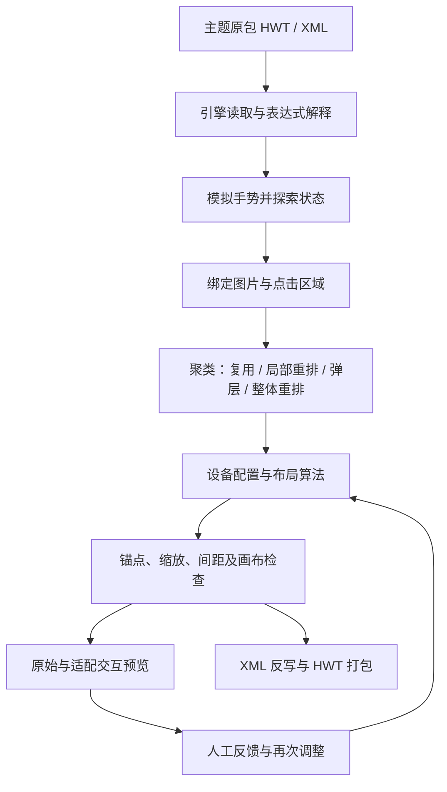

# 项目结构与各部分作用

## 先理解整体流程

这个项目解决三个相互衔接的问题：**主题能进入哪些状态、每个状态应该怎样布局、如何把布局写回主题包**。



箭头表示处理流程；源码分组沿用现有依赖关系，暂未把所有循环依赖改造成严格单向架构。

## 一、日常最常用的目录

| 目录 | 放什么 | 什么时候看 |
|---|---|---|
| `configs/` | 设备尺寸、方向和适配策略 | 增加设备、修改画布 |
| `theme/` | 真实主题、适配结果、相关主题示例 | 选择输入、查看实际输出 |
| `samples/` | Mock 输入和算法演示 | 验证想法、理解接口 |
| `src/multires_app/` | 可运行的项目代码 | 修改逻辑 |
| `tests/` | 测试与真实主题验证脚本 | 按需做回归和专项验证 |
| `docs/` | 设计、使用说明和修复报告 | 理解规则与历史决策 |
| `artifacts/` | 日志、测试摘要和整理记录 | 查运行问题与证据 |
| `archives/` | 以前的项目压缩快照 | 追溯旧版本 |

## 二、源码各部分的作用

下面所有位置都相对于 `src/multires_app/`。

### 1. `engine/`：读懂主题脚本

| 文件 | 作用 |
|---|---|
| `scene_engine.py` | 读取 XML、计算变量与表达式、解释动画、得到元素几何和显示状态 |
| `archive_safety.py` | 检查归档路径、大小、嵌套资源等输入边界 |
| `engine_capabilities.py` | 生成引擎能力与版本风险报告；后续字段级规则与引擎适配器设计见 [HarmonyOS 5+ 改造清单](guides/HARMONYOS5_IMPLEMENTATION_PLAN.md) |

前一轮的 `atan` 动画角度问题在这一层解决。

当前 `scene_engine.py` 是部分旧版锁屏 XML 的参考解释器。完整的 5+ 引擎迁移还需要目标语义、系统数据、模块路由与官方工具出包，范围见 [规范与迁移方案](guides/HARMONYOS5_MIGRATION.md)。

### 2. `interaction/`：理解人怎样操作

| 文件 | 作用 |
|---|---|
| `interaction_semantics.py` | 将点击、滑动、长按等变成按下/移动/抬起事务；探索与重放状态 |
| `animation_semantics.py` | 从脚本依赖区分人工控制的动画与自动播放；保存连续跳转和样式选择的场景身份 |
| `interaction_ir.py` | 整理交互规则、变量依赖和潜在影响范围 |
| `interaction_bindings.py` | 判断图片、文字与点击区域是否属于同一组件 |
| `interaction_history.py` | 保存有序操作、快照、撤销与历史分支 |
| `tablet_interactions.py` | 专门的平板设计示例与交互构建辅助 |

“按钮看起来在这里，但点不到”和“滑动后才出现的控件”主要从这里排查。

### 3. `pipeline/`：串起整个转换过程

| 文件 | 作用 |
|---|---|
| `scene_pipeline.py` | 创建项目、推断组件、加载算法、重新布局、导出脚本和主题包 |
| `scene_clusters.py` | 比较场景，选择复用、局部变化或整体重排，保存公共组件位置 |
| `scene_analysis.py` | 汇总场景与交互分析材料 |
| `source_comparison.py` | 获取未修改的原始主题画面，作为适配参照 |
| `layout_storage.py` | 压缩重复布局证据，保存运行所需数据 |

建议从 `scene_pipeline.py` 的 `create_project()` 开始阅读整个项目。

### 4. `layout/`：决定组件摆在哪里

| 逻辑 | 主要文件 |
|---|---|
| 默认布局算法与算法接口 | `anchor_layout.py`、`layout_api.py` |
| 九宫格锚点、组件分组和容器 | `anchor_ir.py` |
| 软硬约束求解 | `anchor_solver.py` |
| 居中、贴边、底部平均分布 | `screen_relations.py` |
| 跨组件对齐 | `spatial_alignment.py` |
| 左右、上下间距与非重叠 | `spatial_flow.py` |
| 整体资源尺寸和缩放策略 | `visual_scaling.py` |
| 图片透明区域与可见边界 | `visual_geometry.py` |
| 左下/右下角落按钮 | `footer_components.py`、`corner_geometry.py` |
| 弹窗与时间等组件的缩放关系 | `panel_scaling.py` |
| 图片时钟语义识别 | `clock_semantics.py` |
| 屏外隐藏、入场前等待 | `offscreen_geometry.py` |
| 拆分远距离区域、背景与组合图层 | `composition_sections.py`、`composition_layers.py`、`background_layers.py` |
| 画布边界与最终导出约束 | `canvas_bounds.py`、`anchor_validation.py` |
| 美学代理评价、优化与回退 | `layout_aesthetics.py`、`aesthetic_layout.py`、`aesthetic_optimizer.py`、`layout_quality.py` |
| 预览中编辑锚点与规则 | `anchor_tools.py` |
| 旧布局候选 | `adaptive_layout.py`、`ordered_layout.py` |

你后续加入自己的算法，优先看 [自定义算法说明](CUSTOM_LAYOUT.md)。原有约束和评价可作为独立的输入、检查或评分环节。

### 5. `media/`：处理随时间变化的资源

| 文件 | 作用 |
|---|---|
| `media_layout.py` | 首帧参考、后续帧沿用变换，以及媒体相位与交互状态的区分 |
| `media_support.py` | 媒体资源的识别和处理辅助 |
| `resource_scaling.py` | 为不支持直接缩放的原生位图字形生成对应资源 |

核心规则是：播放相位不等于新的交互场景；首帧参考也不能把已打开的面板变回关闭状态。

初始化停止值、屏外等待组件及连续跳转的统一规则见 [交互动画与初始可见性](guides/INTERACTION_ANIMATION.md)。

### 6. `preview/`：看效果、做交互与微调

| 文件 | 作用 |
|---|---|
| `scene_previewer.py` | 将项目、素材和场景数据组装成预览页面 |
| `interaction_server.py` | 本机实时交互接口，执行原始侧和适配侧操作 |
| `scene_viewer.html`、`scene_viewer.js` | 两侧画面、设备选择、操作过程与素材显示 |
| `anchor_layout_ui.js` | 预览中的九宫格与组件组编辑 |
| `layout_refinement.py`、`layout_refinement_ui.js` | 导入导出布局建议、审查并应用 |
| `reference_matching.py` | 将预期图片中的区域与已有素材做局部匹配 |
| `previewer.py` | 旧版元素级布局预览 |

### 7. `export/`：把布局写回 XML

`layout_writeback.py` 负责精确修改布局属性，保留原脚本结构并记录补丁。完整 HWT 的资源汇集和打包入口仍在 `pipeline/scene_pipeline.py` 的导出流程中。

### 8. `service/`：给客户使用的服务层

| 文件 | 作用 |
|---|---|
| `saas_api.py` | 客户 API、鉴权、上传、预览授权和结果下载 |
| `saas_store.py` | 客户、任务、版本和状态存储 |
| `saas_jobs.py` | 有界任务队列与转换子进程管理 |
| `saas_worker.py` | 隔离执行实际转换、微调和发布候选 |
| `saas_dashboard.html` | 客户工作台 |

它与本地调试用的 `preview/interaction_server.py` 是两个入口。现阶段服务仍为受控内测。

### 9. `tools/` 与 `cli/`：运行项目

`cli/multires.py` 接收 `analyze`、`scenes`、`relayout`、`export`、`serve` 等命令。根目录 `multires.py` 只是启动器。

`tools/` 保存批量转换、布局迭代、刷新预览、重打包和报告维护工具，统一使用：

```text
python multires.py tools <工具名> <参数>
```

`python multires.py tools --help` 列出所有可用工具。

### 10. `evaluation/`：从批量验证回到可修复的问题

`core.py` 定义版本化观察、上下文和评价/修复插件接口；`checks.py`、`input_checks.py`、`replay.py` 检查选中布局、源输入和交互；`responsive.py` 记录宽高变化时的关系图；`gate.py` 阻止逐场景退化；`report.py` 生成有预算的图像证据与流式报告；`workflow.py` 连接候选、标注、固定回归与断点恢复。

通过 `python multires.py tools feedback-loop --help` 运行。新布局算法仍使用原来的 `layout_scene` 接口；评价和候选提案可分别替换。详见 [反馈闭环](guides/FEEDBACK_LOOP.md)。

## 三、真实主题目录怎么读

当前真实主题源包直接在 `theme/` 下；已有项目在 `theme/adaptation/`。为保留项目中记录的路径，本轮没有移动这些大体积数据。

```text
theme/
├─ *.hwt                         你提供的原始主题
├─ adaptation/
│  ├─ index.html                 全部主题入口
│  ├─ batch-summary.json         批量处理结果
│  ├─ *validation.json           跨项目专项证据
│  └─ theme-编号/
│     ├─ source-profile.json     原始画布配置
│     ├─ scenes/                 当前有效结果
│     ├─ scenes-before-.../      各轮修复前备份
│     └─ *.log、*.png            对应主题的日志和截图
└─ tablet-2560x1600/ 等目录       专门设计、演示或历史流程产物
```

`scenes/` 是当前结果；`scenes-before-*` 是历史备份。一个项目的“96 个状态”表示采样探索结果，不能理解为全部可能操作已经穷尽。

## 四、建议阅读顺序

1. [快速使用](QUICKSTART.md)：先打开现有预览。
2. `pipeline/scene_pipeline.py`：理解输入、状态、布局与输出。
3. `interaction/interaction_semantics.py`、`pipeline/scene_clusters.py`：理解交互和聚类。
4. `layout/anchor_layout.py`、`anchor_ir.py`、`anchor_solver.py`：理解自动求解。
5. [自定义算法接口](CUSTOM_LAYOUT.md)：替换自己的算法。
6. [文档导航](README.md)：按需要查看历史设计、修复和服务文档。
