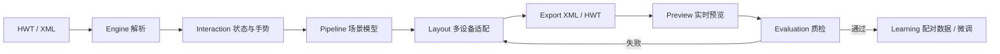

# 当前项目架构导航

**2026-10-24 更新**：本轮已实际拆分主流程、导出编译和实时预览模块，并完善新编辑器的设计推断布局。先看 [重构说明](REFACTORING.md)、[Python 新入口](../../src/multires_app/README.md)、[新编辑器](../../theme_studio_v2/README.md)。下面的表格保留兼容路径，原有命令可继续使用。

> 当前项目：`F:\multi-res`。本目录是导航，现有的详细技术描述请仍以 [PROJECT_STRUCTURE](../PROJECT_STRUCTURE.md) 为准。本轮不移动源码、主题、模型或训练数据。

## 业务主链路

> 上图为**业务数据流**，不是已经消除循环依赖的 Python 包图。实际绝对导入关系统计可运行 `scripts/project_inventory.py` 获取。

## 从需求快速找到代码

| 要做什么 | 首选模块与关键文件 |
|---|---|
| 读取脚本、变量、坐标和动画 | `src/multires_app/engine/scene_engine.py` |
| 点击、长按、滑动、嵌套交互状态 | `interaction/interaction_semantics.py`、`interaction_ir.py` |
| 场景建模、聚类、组件关系 | `pipeline/scene_pipeline.py`、`scene_clusters.py` |
| 自定义布局、锚点、约束求解 | `layout/layout_api.py`、`anchor_layout.py`、`anchor_solver.py` |
| 布局反写与保留脚本行为 | `export/layout_writeback.py`、`interaction_preservation.py` |
| 实时锁屏预览、互动反馈 | `preview/live_preview.py`、`interaction_server.py` |
| 质量评分与迭代反馈 | `evaluation/checks.py`、`gate.py`、`workflow.py` |
| 数据集、SFT、Qwen3-VL | `learning/dataset.py`、`qwen_runner.py` |
| 对外服务 / API | `service/saas_api.py` |
| 统一命令入口 | `multires.py` → `src/multires_app/cli/multires.py` |

表中的 `interaction/` 等短路径均相对 `src/multires_app/`。

## 三条互不混淆的流程

1. **真实主题主流程**：`multires.py scenes / export / live / tools ...`，结果可在 `theme/adaptation/` 查看。详见 [快速使用](../QUICKSTART.md)。
2. **主题工作室与自动化实验**：`studio_reverse/`，包括独立多设备预览器、Playwright 浏览器操作台、公开素材/主题生成器。详见 [实验目录](../../studio_reverse/README.md)。这不是华为官方平台源码。
3. **模型数据与训练实验**：实验生成器产物放在 `artifacts/learning/`，模型接口在 `src/multires_app/learning/`；交互、资源、布局未验收的样本不能标为真值。

## 数据与目录应该放在哪里

- `src/multires_app/`：长期维护代码。已有一次大规模模块迁移，**不要再次盲目改 import**。
- `tests/`：自动化回归；`samples/`：小示例；`configs/`：配置和 schema；`scripts/`：开发工具。
- `theme/`：真实主题与已有适配项目；`new_adaption/`：专项输出；**保留现有路径**。
- `artifacts/`：模型、数据、日志、报告、缓存混合目录，**不是纯临时目录**。
- `eval/`：评分与 Badcase；`preview-live/`：预览会话数据；`archives/`：历史快照。
- `docs/`：规范、指南、报告；本目录只提供入口，不重复维护业务真相。

## 实验工作区与产物导航

- [artifacts 产物索引](../../artifacts/INDEX.md)：分类、数据版本、重要存储边界。
- [实验工具统一入口](../../studio_reverse/README.md)：浏览器/静态数据/多交互主题的统一调用。
- [多交互脚本归类](../../studio_reverse/web_theme_pipeline/README.md)：推荐与历史入口、验证级别。
- 自动生成实际目录报告：`python studio_reverse/manage.py artifacts-index` 和 `python studio_reverse/manage.py studio-audit`。

## 推荐阅读顺序

[运行命令](RUNBOOK.md) → [项目细分结构](../PROJECT_STRUCTURE.md) → [数据与实验约定](DATA_AND_EXPERIMENTS.md) → [安全整理方案](SAFE_CLEANUP.md) → [历史文件迁移表](../ORGANIZATION.md)。

本轮 Git 原状态包含未提交的根 README、流程图和 `studio_reverse/`；只添加新的导航和只读盘点脚本，不覆盖用户历史产物。
