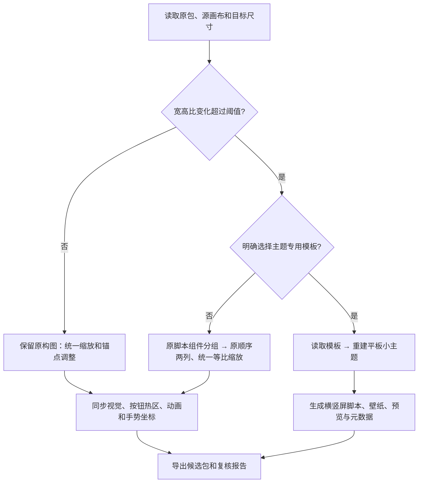

# 保留布局与组件重排：代码化适配流程

主入口是 `theme_adapter.py`。最新默认策略为 `anchor`，锚点/容器/约束与质量回退见 [ANCHOR_LAYOUT.md](ANCHOR_LAYOUT.md)。本篇介绍仍可显式选择的旧 `adaptive_layout.py` 两列策略及人工模板；`--algorithm adaptive`、`--algorithm reflow` 均保留。

两款主题上次的人工平板构图也已抽到 `theme/tablet-2560x1600/tablet-layouts.json`。该模板由 `build_tablet_themes.py` 读取，不必在 Python 中逐处修改位置常量。

## 1. 如何决定保留还是重排



判断依据是**形状变化**，不是绝对像素差。原比例 `Rs=源宽/源高`，目标比例 `Rt=目标宽/目标高`：

```python
aspect_change = max(Rt / Rs, Rs / Rt) - 1
strategy = "reflow" if aspect_change > 0.18 + 1e-9 else "preserve"
```

默认 18% 是可调的工程启发值，并非华为规范。比如 1080×2160 → 2160×4320 的像素数翻倍但比例完全相同，会保留构图；→ 1080×2280 也保留；→ 1600×2560 或 2560×1600 则重排。可以用 `--aspect-threshold` 或 profile 的 `adaptation.aspectThreshold` 修改阈值，也可用 `--mode preserve/reflow` 强制策略。

接近正方形时，仅横竖方向标签改变不再强制重排；仍按实际宽高比差判断。数值边界包含很小的浮点容差。

## 2. 变化较小：保留构图

`AdaptiveThemeLayout.preserve()` 对原画布作统一等比缩放，并按安全区居中。默认所有组件沿用同一个画布关系；可显式为部分组件设置 `layout.anchor=top/bottom/center/original`。

管线使用**相同交互状态在源画布上的几何**作参照。原脚本已经通过 `#screen_height` 调整的底部控件，不会再额外移动一次。不会逐个把原本伸出屏幕的装饰“拉回屏内”，以免拆散图层。物理像素与主题引擎逻辑坐标分开计算，避免重复放大。

全屏手势层单独覆盖整个视口；背景采用等比覆盖。主体图、图标、文字等视觉组件保持等比，不作 X/Y 独立拉伸。安全区的 `safeInsetsPx` 会转换成引擎坐标后参与计算。

## 3. 变化较大：保留原脚本的组件重排

`AdaptiveThemeLayout.reflow()` 使用以下规则：

- XML 组及其按钮为原子组件，组件内部的文字、动画、图层关系保留。
- 显著重叠的视觉层归入同一块；显式 `layout.group` 可以把分散的图层放到同一块。
- 默认全部普通组件按源画布的上到下、左到右顺序进入两列；第一行 1、2，第二行 3、4。单个不可拆分组件居中显示一列。
- 所有组件块共用一个等比缩放值，保持角色、文字和卡片之间的相对尺寸。按各行最大高度与列宽计算容纳比例，不对每块分别放大或压缩。默认不超过源逻辑尺寸的 1 倍；物理像素密度缩放由主题引擎承担。
- 行间距、列间距和外边距可按目标物理像素配置，也可使用比例。组件内部原有间距和叠层关系保留。`ordered_layout.py` 实现具体的排列、缩放与源坐标映射。
- 状态切换继续使用 reuse / local-reflow / overlay 调度。相同几何直接复用；局部变化保留上个布局的缩放并应用源布局中的位移差；越界、产生新重叠或新增独立组件时再提升为完整两列重排。弹窗叠加在上一布局上。
- 不再仅凭相似外形把不同尺寸素材缩放成上一素材的大小，避免改变源设计中角色和字体的相对比例。
- XML 回写继续同步按钮热区、位置/大小动画、手势坐标映射，原命令和变量条件保留。

默认配置如下。`rowGapPx/columnGapPx/marginPx` 是目标物理像素，管线会换算为主题逻辑坐标；省略时使用 `gapRatio=0.025`、`marginRatio=0.035`。`flow=column-major` 可切换为先左列后右列：

```json
{
  "adaptation": {
    "mode": "auto", "aspectThreshold": 0.18,
    "flow": "row-major", "maxScale": 1.0,
    "rowGapPx": 40, "columnGapPx": 64, "marginPx": 56
  }
}
```

每个布局的 `adaptationPlan` 保存顺序、分列、共用缩放值、实际间距、块成员和目标边界，便于检查。它与交互历史分离；布局复用不会合并变量和实际操作轨迹。

若 profile 显式配置自己的 `regions`，继续使用之前的区域布局作为人工覆盖，坐标为安全区内部的归一化比例：

```json
{
  "adaptation": {
    "mode": "auto",
    "aspectThreshold": 0.18,
    "regions": {
      "hero": [0, 0, 0.4, 1],
      "cards": [0.45, 0, 0.55, 1]
    }
  }
}
```

生成的 `components.json` 中，可以给对应组件补充以下字段，再通过 `--components` 重新布局。`id`、`roots`、`members` 使用实际生成的值：

```json
{
  "layout": {
    "region": "hero",
    "group": "bear-character-stack",
    "order": 0,
    "anchor": "center",
    "minScale": 0.4
  }
}
```

`layout.order` 可以显式覆盖原视觉顺序（建议需排序的组件都填写），`layout.group` 把有关的图层作为整体。区域覆盖中同组组件应放在同一区域。新的重叠、越出安全区或低于 `minScale` 会记录在 `project.json` 的 `adaptationReview` 和 `report.json` 的统计中。复杂主题的自动分组不能替代设计复核，尤其是本身用一个巨大 Group 装入全部 UI 的脚本；此时需要用 `--components` 指定真实组件边界，或使用主题专用模板。

## 4. 主题专用模板：复现上次两款平板主题

### 横屏时间、日期与留白

横屏重排后，`aesthetic_layout.py` 从原生 Time/Date/DateTime 及小时/分钟/日期变量驱动的位图组识别时间日期组件。识别时沿用完整小组，避免把数字、分隔符或按钮拆散；显式混合图文组无法安全拆分时保持原位置。日期的常用 DateTime 格式可离线预览，完整系统本地化仍以原生引擎为准。

算法用实际可见元素矩形建立占用区域，扩张留出安全间隔，再通过矩形分割和条带扫描寻找能容纳时钟组的大留白。候选位置限左半区或上部约三分之一区域；先满足安全区、无碰撞等硬约束，再比较偏好、留白、对齐、视觉重心、跨状态稳定性得分。保持原比例和组内关系，仅平移时间日期整体。提升不足或没有合适区域就保留原位置。

```json
{
  "adaptation": {
    "aesthetics": {
      "enabled": true,
      "minWhitespaceRatio": 0.06,
      "clearancePx": 24,
      "minGain": 0.03,
      "weights": {"preference": 3, "whitespace": 1, "alignment": 1, "balance": 1, "stability": 0.5}
    }
  }
}
```

这些是可调设计启发值，不是华为规范，也不是视觉效果保证。候选数、所选留白、分项得分及保留原因记录到 `adaptationPlan.datetimePlacement`。需要强调时钟的组件可显式设置 `layout.semantic: "datetime"`；CLI `--no-aesthetics` 关闭自动留白定位。进一步人工微调或参考图匹配见 [LAYOUT_REFINEMENT.md](LAYOUT_REFINEMENT.md)。

### 显式平板模板

这是显式选择的重建设计路线，会简化原手机功能。默认通用路线不会擅自切换到它。

`tablet-layouts.json` 保存横竖屏的画布、时钟、日期、熊角色/小狗、卡片、装饰物和按钮位置。比如修改 `bear.landscape.character` 为 `[x,y,w,h]`，即可调整熊的位置与大小。

`build_tablet_themes.py` 按模板生成原生 XML 和同源预览，读取原包角色与图标，删除平板不适用的桌面 hwext，生成 WUXGA 描述文件、3200×2560 壁纸、默认及横竖屏脚本，校验后打包。新增水面使用上次已保存的 `sea-master.png`，重建无需再次调用 AI。

模板的功能取舍见 `theme/tablet-2560x1600/适配说明.md`：没有移植原手机的全部设置面板、桌面小组件或系统大主题皮肤。模板中的实时数据仍由系统提供。脚本离线表达式计算已改用白名单 AST 解释器。

当前模板构建器输出交互增强 v2，增加角色反馈、滑动换装、长按简洁模式、电量联动和持久设置。默认输出目录为 `theme/tablet-2560x1600/v2/`；统一入口指定 `--out` 时写入该指定目录。原版包和 v1 平板包保留，具体操作及包级验证见 `theme/tablet-2560x1600/v2/交互与验证说明.md`。

## 5. 运行

在仓库目录执行，核心环境依赖见 `requirements-core.txt`（Pillow、NumPy），在线服务依赖见 `requirements-service.txt`。现有 `.venv` 可直接运行。

相近尺寸，保留原主题布局与资源：

```powershell
python .\multires.py tools theme-adapter 'theme/比邻熊 新拟态.hwt' --width 1080 --height 2280 --out theme/workflow-output/bear-phone
```

变化较大，先生成保留原脚本的组件重排候选：

```powershell
python .\multires.py tools theme-adapter 'theme/线条小狗 夏日出逃.hwt' --width 2560 --height 1600 --flow row-major --row-gap 40 --column-gap 64 --margin 56 --out theme/workflow-output/dog-grid
```

明确使用上次的平板专用模板，生成完整平板小主题：

```powershell
python .\multires.py tools theme-adapter 'theme/比邻熊 新拟态.hwt' --width 2560 --height 1600 --recipe tablet-preset --out theme/workflow-output/bear-tablet
python .\multires.py tools theme-adapter 'theme/线条小狗 夏日出逃.hwt' --width 2560 --height 1600 --recipe tablet-preset --out theme/workflow-output/dog-tablet
```

使用自己修改的模板：追加 `--design path/to/tablet-layouts.json`。模板目前对应本次的 2560×1600 / 1600×2560；其他比例可用通用策略或补充专用模板。

源画布默认从脚本和预览推断，不代表实机测量；已知真实画布时请传入 `--source-profile source-profile.json`。可用 `--max-states`、`--max-depth` 控制交互探索预算；未探索分支会保留为 bounded。

一次生成两款主题的四种目标示例：

```powershell
python samples/run_adaptive_examples.py
```

示例目标配置位于 `samples/adaptive-profiles.json`；结果在 `theme/adaptive-code-demo/`，包含项目、对比预览、策略、XML 和复核报告。

已有项目不必重新解包和探索：

```powershell
python multires.py relayout theme/adaptive-code-demo/bear/project.json --algorithm adaptive
```

## 6. 导出与验证边界

通用 `generic` 路线只替换动态锁屏脚本，保留原包其余内容。其 HWT 是脚本适配候选，**不会自动变更手机主题品类元数据、壁纸尺寸或平板专用清单**。需要完整平板主题时使用已有平板专用模板，或补充包级转换。这个区别在 `adaptation-report.json` 的 `scope` 中明确记录。

模板路线检查 ZIP、XML、方向命名、壁纸尺寸、资源引用、布局边界和手势条件。两条路线都不等同于鸿蒙真机验收。原包不被覆盖，输出记录源 SHA256 和 `sourceUnchanged`。

回归验证：

```powershell
python -m unittest discover -s tests -v
```

测试覆盖比例判断、接近正方形的方向变化、阈值边界、像素密度变化、安全区换算、响应式锚点、原始越界装饰、原顺序双列/统一缩放/间距、连续状态稳定性、显式模板选择，以及 XML 反写与原包内容保留。开源方案对比和资源拉伸/生成的处理边界见 [LAYOUT_RESEARCH.md](LAYOUT_RESEARCH.md)。
