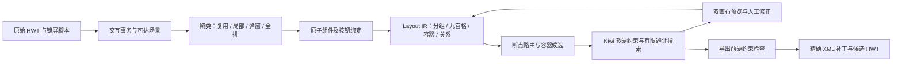

# 九宫格锚点、容器与约束求解

本轮实测数据、质量回退与尚待复核项见 [ANCHOR_LAYOUT_RESULTS.md](../reports/ANCHOR_LAYOUT_RESULTS.md)。工程检查通过不等于构图和原生设备验收通过。

## 项目分析与本次落地

当前项目已形成完整锁屏候选生成链路：脚本解释 → 人工手势事务 → 有界可达场景 → 布局聚类 → 原子组件与交互绑定 → 目标设备布局 → 预览 → 状态条件反写 → HWT。客户工作台、版本回退与后台任务也已存在。

原布局的主要缺口是设计关系没有独立表示：`adaptive` 在比例剧变时主要依赖两列排布，几何关系、锚点和公共组件锁定分散在不同模块。新默认 `anchor` 在这些已有能力之间增加可解释的 Layout IR 与关系求解，保留 `adaptive`、`reflow` 和自定义 `layout_scene()` 接口。



| 层 | 文件 | 本次作用 |
|---|---|---|
| 结构发现 | `anchor_ir.py` | 空间邻域、排列结构验证、置信度与依据、嵌套组无环/唯一父节点校验 |
| 九宫格 | `anchor_ir.py`、`anchor_solver.py` | 父/自身锚点，固定与归一化偏移，配对人工目标校准 |
| 容器 | `anchor_ir.py` | Rigid、Row、Column、Overlay、基础 Grid，padding、对齐、逐对自定义 gap |
| 求解 | `anchor_solver.py` | required/strong/medium/weak；等比、边界、冻结、对齐、间距、尺寸关系；有限离散避让 |
| 调度 | `anchor_layout.py`、`scene_clusters.py` | 相近形状锚点迁移，剧变时搜索行列轨道，冻结公共组件，复用不重复求解 |
| 可视修正 | `anchor_layout_ui.js`、`anchor_tools.py` | 九宫格/锚点/组轮廓，合组拆组、容器/锚点修改、导出 JSON、实时事务应用 |
| 导出防护 | `anchor_validation.py`、`layout_writeback.py` | 再查硬约束、公共锁定；只补丁允许字段，保留原文本、素材引用与原节点顺序 |

## 核心规则

- 锚点公式：`x = parent.x + u*parent.w - us*group.w + dx`，y 同理。求解时自身尺寸也在等式内；缩小时不会把中心锚点变成左边缘。
- 锚点名是 `top_left / top_center / top_right / center_left / center_center / center_right / bottom_left / bottom_center / bottom_right`；也接受连续 `[u,v]`。
- 背景与全屏手势层分别走覆盖和热区映射；不参加普通排列聚类。按钮继续绑定原视觉组件，组件内部及原绘制顺序保持。
- 自动 Row/Column 需相邻间距、对齐、尺寸及角色共同满足；整组再次验证，避免斜着串联或跨大空白合组。同高度本身不足以成组。推断不是设计师标注，输出置信度与复核标记。
- Rigid/Overlay 保留组内相对关系；Row/Column 支持原有不等距和明确 gap；Grid 目前只实现规则轨道，不包含 CSS 完整 Grid。
- 同一状态源画布的几何用于锚点和顺序，目标脚本已响应的 `screen_height` 不会再简单重复缩放。
- 公共组件以 required 等式冻结；不可行会失败。碰撞方向属于离散决策，先在求解器外选方向；冲突后最多尝试 48 次替代组合。不会删除 required 锁定以换取成功。
- 原本叠加的图层、弹窗与明确裁剪不会被一律禁止重叠。已接受基准场景的公共组件裁剪会继承并注明原因。
- Kiwi 按数值强度优化软约束，记录每条未满足关系及残差。它不是严格字典序优化；不声称一定按强度逐条撤销。Required 始终是硬约束。
- 跨设备/状态重复的源 IR 使用摘要引用保存；相同布局继承分析，减少重复数据。
- `layout_quality.py` 对自动推断方案执行同场景旧算法比较；若新增裁剪或可疑重叠的数量增加，且旧候选满足原公共组件冻结对，就回退该设备的全部采样场景。回退记录为 `baseline-rollback`，保留推断 IR 供修正，但不把已拒绝的推断当成已满足的硬设计关系。显式配置不自动撤销；旧候选会破坏公共冻结时保留求解结果并标注复核。新产生的实时场景继续执行冻结约束，不会为回退重写此前操作历史。

## 使用

安装项目依赖后，现有 `scenes`、`relayout`、`theme_adapter.py` 与批处理默认使用 `anchor`：

```powershell
.\.venv\Scripts\python.exe -m pip install -r requirements-service.txt
.\.venv\Scripts\python.exe multires.py relayout theme/adaptation/wufu/scenes/project.json --algorithm anchor
.\.venv\Scripts\python.exe .\multires.py tools batch-convert --resume --relayout --workers 3
.\.venv\Scripts\python.exe .\multires.py tools iterate-anchor-layout --workers 3
.\.venv\Scripts\python.exe tests/validate_anchor_real.py
.\.venv\Scripts\python.exe multires.py serve theme/adaptation --port 8766
```

预览中开启“九宫格与组锚点”。选择组后记录锚点/容器建议，或多选组件合组、拆组。点击“求解并应用到此设备”时，重新求解该设备全部已采样场景；成功才替换会话布局，失败保留原候选。当前编辑范围是**此设备全部采样场景**，不是跨设备批量生效。接受/拒绝与原因保留在会话 `anchorFeedback`，导出项目时一并保存。重启会话会回到磁盘版本。

离线页面下载 `anchor-config.json`，再运行：

```powershell
.\.venv\Scripts\python.exe multires.py relayout theme/adaptation/wufu/scenes/project.json --anchor-config path/to/anchor-config.json
```

配置也可写到目标 profile 的 `adaptation.anchorLayout`。所有数值使用**主题引擎逻辑坐标**，物理像素只有 `gapPx`；`safeInsetsPx` 由现有转换器换算。这是对 Word “屏幕绝对坐标”的工程区分：IR 标识 `source_screen/group_local/target_screen`，不把实际面板像素再次乘进脚本。

```json
{
  "gapPx": 24,
  "minScale": 0.03,
  "maxScale": 1.0,
  "groups": [{
    "id": "header-row",
    "members": ["替换为真实时间组件ID", "替换为真实日期组件ID"],
    "container": {"type": "row", "gaps": [18], "align": "center", "padding": [0, 0, 0, 0]},
    "anchor": {"parent_id": "screen", "parent_point": "top_center", "self_point": "top_center", "offset": [0, 80], "offset_unit": "px"},
    "size_policy": "uniform_scale"
  }],
  "constraints": [{
    "type": "align", "targets": ["替换为真实时间组件ID", "替换为真实日期组件ID"],
    "edge": "center_y", "priority": "strong", "weight": 1, "provenance": "designer"
  }]
}
```

示例 ID 必须替换，未知 ID 会拒绝。组的成员可以是组件 ID 或其他组 ID；组 ID 与组件 ID 不能重名。全场景配置中的暂时隐藏成员会在对应场景停用。`ungroupedIds` 可阻止指定组件再次自动合组。

支持关系：`align`、`gap`、`preserve_order`、`non_overlap`（方向 right/left/below/above）、`position`、`size`、`min_size`、`max_size`、`equal_size`、`containment`。`priority` 为 required/strong/medium/weak，weight 在 0.001–100。公开的硬约束不被自动降级。

`size_policy`：fixed、uniform_scale、contain、cover（均保持组内比例）。内容组 cover 仍受边界约束；需要裁剪必须显式 `allow_crop:true`。独立轴拉伸不对关键内容开放，只有全屏手势覆盖使用独立轴映射。

V1 每个最外层组共用一个等比尺度；嵌套 fixed 组会将这一尺度锁为 1，嵌套最小尺度向父组传播。若固定尺寸与可用空间冲突就拒绝候选，不会悄悄缩小。子组各自伸缩、完整 Flex/Grid 与非线性旋转/裁剪求解属于后续扩展。

`pairedTargets` 可按实际组 ID 提供人工配对：`{"组ID":[{"viewport":{"width":1260,"height":2800},"bbox":{"x":980,"y":80,"w":200,"h":100}}]}`。单画布距离只能提供先验，不能证明锚点正确。

## 输出与后续接入自有算法

- `anchor-layout.json`：按设备、状态组织的组、目标 bbox、软约束残差、冻结项及共享源 IR。
- `scripts/<target>.patch.json`：实际属性补丁、生成参数、资源与原节点顺序校验。
- `project.json`：新增 `anchorIRs`、`adaptationPlan.layoutIRRef`，保留原有状态图与插件接口。
- `theme/adaptation/anchor-validation-summary.json`：本次真实包复测结果与检查范围。
- `theme/adaptation/anchor-ab-report.json`：相同源场景下与旧算法的离线几何比较；不是人工审美评分。

自有算法仍实现 `layout_scene(components, source_profile, target_profile, context)`，返回 `{component_id:{sx,sy,tx,ty}}`。也可以复用 `build_ir()`、`local_geometry()`、`solve_directions()`，或替换其中一步。布局 IR 与主题反写没有绑定到 Kiwi 的对象。

## 写回与验收边界

### 稳定场景边界与视觉缩放（2026-10-17）

默认 `resourceScalePolicy` 为 `balanced`。屏幕比例变化不超过 18% 时沿宽度等比缩放；变化更大时使用宽高倍率的几何平均，并限制相对屏幕面积占比倍率不超过 1.25、单轴占比倍率不超过 1.6。可通过 `similarAspectThreshold`、`maxRelativeAreaScale`、`maxRelativeAxisScale` 调整；也保留 `width`、`contain`、`fixed` 策略。

在上述视觉基准上，稳定场景可见资源必须完整位于目标安全区域。约束覆盖组内图片、文字、视频画布和按钮热区，而非仅检查组外框；必要时统一缩小整个组件组。贴边、居中、均分和九宫格相对关系作为布局偏好继续参与求解，画布边界与人工 required 约束、公共组件冻结为硬约束。硬约束互相冲突时拒绝导出并报告原因。

`context.stableResources` 提供当前稳定快照的资源矩形；首帧参考仍由 `context.mediaLayout` 提供。源稳定画面与源画布相交的资源参与边界约束；完全位于屏外的待展开菜单保留其屏外状态。入场、离场姿态不强制放入画布，整段动画沿用同一仿射变换，不逐帧求解。缺失素材、不可解释表达式以及未探索的交互状态不属于已验证范围。

导出前重新检查实际稳定资源，阻止布局复用、质量回退或手动修改引入越界。全包审计结果见 `theme/adaptation/canvas-validation.json`；视觉占比比较见 `theme/adaptation/visual-similarity-validation.json`。

### 序列帧与视频：首帧布局

`media_layout.py` 在同一人工交互状态下将播放相位设为 0，生成 `layout.mediaLayout`。只替换求解器与聚类使用的几何，预览的 `rows` 保留当前帧。首帧透明时仍保留其画布；首帧尺寸无法解析时写入 `warnings`，不会冒充已完成像素解析。视频用其固定视频画布或脚本指定区域作为首帧布局边界，不需要先解码画面。

`mediaLayout.nodeIndices` 使用 `context.nodeOrder[index]` 对应脚本节点，`rows` 保留首帧参考几何；旧版 `nodeIds` 输入继续兼容。布局回调拿到的是首帧参考，预览继续读取当前帧。最新实测范围见 [MEDIA_LAYOUT_RESULTS.md](../reports/MEDIA_LAYOUT_RESULTS.md)。

暂停后仍采用播放起点的布局参考。为延迟出现的元素预留首帧画布：可见性在固定的 0/100/200/700/1600/2400ms 相位进行有界探测，几何仍在 0ms 读取，人工页面条件保持原值；探测窗外的短暂出现仍可能遗漏。首帧缩放到零时使用首帧素材的自然画布预留空间，按原对齐方式补偿中心，并记录回退原因；实际播放仍从零尺寸开始。媒体帧序号及其依赖变量不参与选择布局变换的脚本条件，整页切换所需的时钟条件仍保留。

后续帧、源位移/透明度动画共享组件的 `{sx,sy,tx,ty}`，不逐帧求解。点击切换页面/样式仍能产生新布局。时间变量及依赖闭包用于识别序列；`ImageSeries` 的数字/文字字形不会被当作连续帧。自有算法的 `context.mediaLayout` 可读取参考数据，原插件接口不变。

反写保留素材与动画轨迹，对所有帧沿用相同仿射参数。`srcid` 序列和常见 `srcExp` 字符串前缀序列会根据所有已知帧的实际尺寸生成尺寸表达式，避免把不同尺寸的后续帧强拉成首帧尺寸。其他动态路径仍使用已有的采样状态反写并列出诊断。首帧布局不保证源动画移动后的每一帧都在安全区域内。

支持旧脚本中的 `SourcesAnimation/Source` 图片切换与帧偏移，Source 的素材与时刻原样保留、偏移按相同尺度反写。语法参考 [MAML 官方元素动画说明](https://zhuti.designer.xiaomi.com/docs/grammar/#元素动画)，用于解释现有旧脚本；这不是鸿蒙原生引擎等价性的证明。复杂动画控制命令与缓动仍需要原生验证。

本地预览新增“采样媒体动画”，默认采样 0–2400ms、步长 100ms，两侧同时展示，沿用既有布局；不写入新状态、历史或触发交互命令。视频依赖浏览器解码，复杂原生缓动/控制命令仍受解释器能力限制。该功能是跨帧几何预览，不能替代原生设备验收。

精确补丁保留源脚本其他文本、注释、属性间距及转义。允许几何字段为 x/y/w/h/width/height/size/space；现有引擎还需要批准的 `mr_` 状态/布局参数及手势坐标逆映射。后一类单独标注为系统变更，不能宣称严格只改四个坐标字段。原资源 ID、普通业务条件、命令目标与原节点顺序改变会拒绝。

当前源文本补丁支持 UTF-8/UTF-8 BOM XML；其他编码不会静默重写。HWT 原件保持只读，输出候选另存。复杂原生动画、视频时序/裁剪、完整系统组件与真实安装验收仍未通过本次静态布局检查。

自动分组尚未使用学习模型或完整 alpha 轮廓（IR 显式标注未知）；已有大图透明裁剪识别继续辅助合成绑定。MLLM 不会在后台擅自上传主题或自动调用，现有离线建议 JSON/NCC 路径继续保留。没有设计师金标准，不能给出分组准确率、审美提升率或一次通过率。可控求解闭环已接入，生产级全主题验收仍需要设备与人工数据。

## 开源研究与选择（2026-10-17）

实际依赖为 [Kiwi 1.4.9](https://github.com/nucleic/kiwi/releases/tag/1.4.9)，采用 BSD-3-Clause；许可证保存在 `third_party/kiwisolver/LICENSE`。[官方接口](https://kiwisolver.readthedocs.io/en/latest/basis/basic_systems.html)支持线性约束与强度，[内部说明](https://kiwisolver.readthedocs.io/en/latest/basis/solver_internals.html)明确软强度为浮点数、不是严格字典序。

[ConstraintLayout](https://github.com/androidx/constraintlayout)用于参考锚点/链关系；[Yoga gap](https://www.yogalayout.dev/docs/styling/gap)用于参考容器间距；[Taffy](https://github.com/DioxusLabs/taffy)保留为复杂 Flex/Grid 后续选择。没有复制这些项目的实现或引入 Android/Rust 运行时。本次 Row/Column/Rigid/Overlay 与基础 Grid 为项目自行实现。
