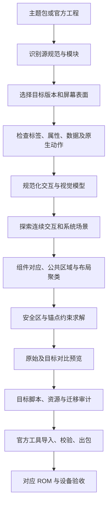

# HarmonyOS 5.0 及以上主题适配方案

研究日期：2026-10-19。代码对照基线：`9c7cfa2`。

本文是规范对照和工程迁移设计。配套文件：

- [逐文件改造清单、接口草案与验收标准](HARMONYOS5_IMPLEMENTATION_PLAN.md)
- [官方来源、阅读范围与待核实项](../reference/HARMONYOS5_SPEC_SOURCES.md)

## 一、先明确适配目标

现有“提取交互 → 场景分层 → 组件绑定和聚类 → 锚点求解 → 预览 → 反写”可以保留。需要在它的前后补上**目标引擎适配、系统能力和官方工具交付**。

要分别处理两类输入：

| 输入情况 | 工作内容 | 成功条件 |
|---|---|---|
| 已经由官方工具制作的 5+ 主题 | 识别规范和模块，解释对应语义，适配设备布局，回到官方工程出包 | 原交互与系统功能保留，目标形态通过工具和真机验收 |
| 旧引擎主题迁移到 5+ | 在上述工作外，转换语法差异、系统数据和原生动作，并迁移到官方工程模板 | 语义迁移记录完整，目标引擎实际可执行 |

当前项目实现了部分旧版锁屏 XML 的参考执行、几何求解和原包反写。`engine-compatibility.json` 是能力提示，`analyze --engine harmonyos-5+` 是分析标签。二者均没有完成引擎迁移。

这次文档提交不改变运行时、导出器或既有主题产物。后续开发按配套清单落地，不能将清单中的拟议字段当成当前支持的配置。

## 二、官方规范对现有方案的影响

### 2.1 引擎版本要独立于分辨率

5+ 的锁屏规范仍提供 `<Lockscreen>` XML，`screenWidth` 定义虚拟宽度。改变物理像素时，应先计算对应的逻辑画布，再使用布局变换；不要同时改设计坐标、资源像素和引擎缩放而重复放大。[锁屏规范](https://developer.huawei.com/consumer/cn/doc/content/themes-engine-next-lock-0000002244659534)

建议分别保存：源规范、目标规范、物理分辨率、逻辑画布、设计模板尺寸、设备形态、系统能力。XML 标签相同只说明存在语法交集，不能证明命令参数、默认值和生命周期一致。

### 2.2 “5.0 及以上”应实现为版本规则集合

规则至少细到 `标签 + 属性/事件 + 根场景 + 最低版本 + 设备能力`。例如 `IntentCommand.uri/type` 从 6.0 起，`Button.longClick` 标为 7.0 起；情绪能力还要求部分设备支持。详见 [Intent 命令](https://developer.huawei.com/consumer/cn/doc/content/themes-engine-next-base-intentcommand-0000002471235064)、[按钮](https://developer.huawei.com/consumer/cn/doc/content/themes-engine-next-base-button-0000002471395018)、[情绪感知](https://developer.huawei.com/consumer/cn/doc/content/emotioncommand-0000002551079172)。

**项目设计建议：**先建立 5.0 基线，再逐条加入已核实的 6.0、6.1 及后续规则。目标信息不足时返回“未知／需核实”，不把版本字符串的大小比较当作完整兼容性判断。

### 2.3 热区安全约束需要加入求解

官方规范对系统安全区域的交互占用有要求。项目当前 `safeInsetsPx` 只能描述四边缩进，不能表达内部指纹区或随系统状态变化的占用区。[5.0 设计规范](https://developer.huawei.com/consumer/cn/doc/content/themes-specification-next-0000002371431700)、[Pura X Max 安全区](https://developer.huawei.com/consumer/cn/doc/content/pura_x_max-0000002581312329)

建议新增两类几何信息：

- **视觉可用区域**：关键内容的可读性、遮挡和画布边界。
- **交互禁入区域**：按钮真实热区、扩展热区和手势起点／路径需要避开的系统区域。

安全约束应先于美学评分。贴边、居中、均分等设计意图在可用空间内求解；两者冲突时给出具体冲突组件与区域，不静默把系统区域视为普通空白。

### 2.4 每种屏幕表面有自己的内容能力

| 目标 | 官方已确认的要求 | 对项目的修改 |
|---|---|---|
| 直板机锁屏 | 独立锁屏规范 | 作为已确认目标的基础适配器 |
| 平板 | 专项规范；Pura X Max 对照表列出平板横、竖两态 | 保存两套布局和对应安全区，而非只交换宽高 |
| 普通折叠屏 | 官方有独立两折叠规范 | 以官方模板补齐折叠／展开路由；现有“两倍宽”配置继续属于研究 mock |
| Pura X 内外屏 | 内外屏内容要求不同；外屏规范给出静态锁屏 | 内屏保留交互方案；外屏建立静态素材生成与裁剪分支 |
| Pura X Max | 折叠、展开横屏、展开竖屏三套锁屏样式 | 建立三态原生资源映射和连续切换验收 |
| 三折叠 | 当前项目有预览配置，本次尚无完整原生路由证据 | 保留研究布局，补齐模板和设备验收后再标记原生可交付 |

来源：[设备专项入口](https://developer.huawei.com/consumer/cn/doc/content/differences-themes-next-0000002505040489)、[Pura X](https://developer.huawei.com/consumer/cn/doc/content/purax-themes-next-0000002505115171)、[Pura X Max](https://developer.huawei.com/consumer/cn/doc/content/pura_x_max-0000002581312329)。

Pura X 外屏要求的方形静态素材，不能由“浏览器中能运行完整交互”替代。已有 `pura-x-view` 等内部预览名，也需要明确映射到实际屏幕角色。

Pura X Max 规范中的设计尺寸，例如折叠态 `1280×1870`、展开横屏 `2600×1840`，与设备面板像素可能不同；不能直接覆盖当前物理分辨率字段。规范示例的方向标注还有歧义，详见来源记录。

### 2.5 系统数据必须保留类型和控制语义

系统数据规范将设备版本、空间、手电筒、旋转开关等列为有类型的输入，并提供专用控制变量。旋转开关值不等于屏幕当前方向，手电筒的读取状态也不能当成任意可赋值的业务变量。[系统数据开放](https://developer.huawei.com/consumer/cn/doc/content/themes-engine-next-base-sysdata-0000002471395102)

当前 `Runtime.lookup()` 在缺少输入时假设为 `0`。5+ 适配器应区分：

1. 已知有效值。
2. 功能不支持或数据不可用。
3. 尚未模拟／未提供输入。
4. 可写的普通主题变量与具有系统副作用的控制变量。

预览中使用有来源的 mock，并显示模拟状态；原生输出保留目标平台的真实数据绑定。天气、健康和媒体的数据变化需要成为场景输入，不能在布局首帧归一化时一起冻结。

### 2.6 应用跳转保留 XML 协议，迁移具体目标

5+ 的主题命令仍是 `IntentCommand`，使用 `package` / `class`。相机的官方示例指向 HarmonyOS 应用及页面。旧 Android 包名、类名或 action 需要按动作语义重新核对，不能只替换字符串前缀。[Intent 命令规范](https://developer.huawei.com/consumer/cn/doc/content/themes-engine-next-base-intentcommand-0000002471235064)

**项目设计建议：**IR 保存“打开相机／打开天气”等动作、原始命令和条件；目标适配器生成有来源的目标命令。第三方目标无映射时保留待处理项。相机受锁屏权限、解锁行为和实际页面影响，需要对应 ROM 验收，文档示例不是免解锁行为的证明。

主题内部的“设置 → 样式 → 返回”仍由状态机解释；系统应用跳转应作为原生副作用记录，不能模拟成主题内部多级页面。

### 2.7 多语言、动画和视频沿用同一场景模型

官方多语言方案涉及语言 JSON 和图片路径表达式。资源解析需纳入语言上下文，布局需检查不同语言的文字宽度和图片尺寸。[图片多语言](https://developer.huawei.com/consumer/cn/doc/content/themes-engine-next-base-picmulti-0000002504354947)

本项目已有规则继续作为工程策略保留：

- 人工交互姿态、自动播放相位、系统数据是不同维度。
- 序列帧／视频用参考帧决定布局，同一场景的后续帧沿用变换。
- 入场／离场保留原运动；稳定内容检查可见性、间距和边界。
- 动画尚未支持的遮罩、旋转、形变等，需增加对应几何适配器或明确记录需人工处理的范围。

“第一帧布局”是本项目的求解策略，不能写成华为发布规范。锁屏媒体、桌面媒体、市场预览视频的文件限制应分别建规则。

## 三、推荐的处理流程

未支持的关键行为在 D / E 阶段就应报告，不能等到预览中缺图后才补救。布局算法仍通过 `layout_scene(...)` 接口接入；引擎语义与原生包路由由公共管线处理。

## 四、交付物应增加什么

以下为**拟新增的项目产物**，不是当前已经生成的文件：

| 产物 | 内容 |
|---|---|
| 引擎兼容性明细 | 每个标签、属性、事件、系统输入的目标支持结论与来源 |
| 模块／屏幕路由清单 | 设计形态与实际工程入口的对应，明确未核实项 |
| 语义迁移审计 | 系统动作、变量、命令容器转换前后的对应及授权规则 |
| 安全区检查 | 关键视觉内容、点击热区、手势路径的分别检查 |
| 系统场景覆盖报告 | 深浅模式、语言、天气、无数据、亮熄屏和形态切换 |
| 官方工具与设备证据 | 工具版本、最终包摘要、ROM、设备、操作步骤和实际结果 |

已有布局反写审计继续保留。语义迁移审计应单独增加，不能放宽原有“只允许几何修改”的检查来容纳任意命令改写。

## 五、先做哪些工作

1. **P0：建立目标信息、官方样例和兼容规则。**先能准确报告哪些能力可用，哪些需要转换，哪些缺证据。
2. **P1：实现 5.0 锁屏适配器。**覆盖基础显示、连续交互、类型化系统数据与已确认原生动作。
3. **P2：接入设备形态、安全区域和原生资源路由。**复用现有锚点、美学迭代与首帧策略。
4. **P3：官方工具出包与真机验收。**通过后再分别增加 6.0、6.1 等增量能力。

工程任务、接口字段、影响文件和验收条件见 [实施清单](HARMONYOS5_IMPLEMENTATION_PLAN.md)。

## 六、当前使用方式与证据边界

现在可以继续生成原包语法下的适配候选，并查看 `engine-compatibility.json`、反写审计和交互报告。现有 CLI 没有完成“指定 5.0 就自动转换并发布”的流程。

本地已有 24 个主题包的离线采样校验与 25 套锁屏输出，不能替代 5.x／6.x 原生验收：这些报告未绑定相应 ROM、官方工具最终包和真实设备操作证据。

只有目标版本规则、布局／交互检查、官方工具产物以及目标设备验收同时具备时，才将对应的“版本 + 设备形态”标记为已完成适配。
