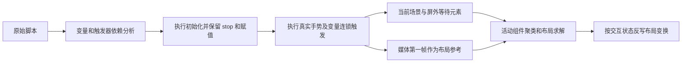

# 通用交互动画与初始可见性

本规则用于当前已支持的锁屏 XML 模型，不根据主题名称、变量名称、资源路径或固定坐标判断。其他格式的主题需要先通过解析适配器生成相同的节点、变量和触发器模型；不能直接视为已经支持其原生引擎。

## 数据流



## 通用规则

| 情况 | 判定依据 | 处理 |
|---|---|---|
| 自动播放的序列帧或视频 | 内容索引、媒体时间线 | 使用第一帧画布求布局；后续帧使用同一变换 |
| 等待滑动或点击的组件 | 人工事件控制的位置、尺寸、透明度或可见性动画 | 保留当前交互值，不用媒体首帧覆盖它 |
| 初始化时停止的动画 | 原脚本中的 stop 或变量赋值 | 保留停止值，不在可见性探测时自动重播 |
| 无独立页面标记的动画切换 | 交互改变了影响视觉的动画变量 | 纳入状态身份和原生布局条件，避免与首页合并 |
| 时间表达式实现的抽屉、翻页 | 人工事件写入的起始时间，经依赖链控制视觉属性 | 保留当前场景位置，而不是把时间归零 |
| 通过变量变化间接触发的动画 | 人工赋值 → 响应变量 → 动画命令 | 沿依赖和触发链识别，不要求动画命令直接写在按钮中 |
| 屏外等待的组件 | 原始画布、当前交互姿态下完全位于对应边缘之外 | 不参与活动区域重排；目标画布变大后仍留在对应边缘之外 |
| 按钮在页面容器外、对应图标在页面内 | 物理绑定与最终页面边界 | 页面分层后重新合并绑定，保证按钮与其图标使用同一组件变换 |

初始化、当前交互值和媒体播放相位是三个不同的数据。`stop` 保存的值不能因为选择视频第一帧被清除。`play` 从事件发生时刻开始，并计算动画自己的 `delay`。预览媒体帧时冻结当前交互姿态，不重新播放页面切换，不修改会话历史。

## 实现接口

- `interaction/animation_semantics.py::scene_animation_names(model)`：从规范化模型提取影响视觉的交互动画变量。分类由脚本关系决定。
- `interaction/interaction_semantics.py::analyze_interactions`：把交互动画加入场景身份和布局条件。真实手势执行仍走原有命令与条件。
- `media/media_layout.py::reference`：保留交互状态，单独归一化媒体相位，记录 `inactiveSceneNodeIndices`。
- `media/media_layout.py::retain_waiting_components`：在求解完成后保持等待组件的屏外边缘，防止更大的目标画布提前显示它。
- `pipeline/scene_pipeline.py::create_model_project`：从已有模型和验证过的资源重建场景、聚类、布局与导出。新上传包仍走原来的归档校验入口。

布局算法接口 `layout_scene(...)` 保持原样。自定义算法接收活动场景的组件；待出现资源的状态判定由公共管线负责。

## 更新旧输出

仅重新排布旧缓存不足以修复此类问题，因为旧状态图可能已经合并了“操作前”和“操作后”。需要重新探索交互并生成布局：

```powershell
.venv/Scripts/python.exe multires.py tools refresh-interactions --audit-only
.venv/Scripts/python.exe multires.py tools refresh-interactions --only <项目目录名>
.venv/Scripts/python.exe multires.py tools repack-layouts --only <项目目录名> --workers 1
```

审计和重建报告写入 `artifacts/reports/interaction-animation-*.json`。重建前核对原包摘要、原脚本及资源缓存；重建先写入临时目录，旧 `scenes` 保留为 `scenes-before-interactions-*`。有人工布局覆盖的项目要求提供显式配置，避免把手工调整当成自动推断重新生成。

自动探索有状态数、深度与手势采样上限。循环命令容器、未实现的原生动画控制及真实设备的缓动行为仍按项目现有能力报告处理；离线检查不代表原生设备认证。

## 连续跳转与时间样式

连续事件在同一运行状态上执行，保存页面上下文、已选择的样式、动画起点与停止值。样式选择涉及的资源索引、字体大小、字间距和其他视觉属性会参与行为状态判断；布局相同可以复用，但不会覆盖用户的样式选择或返回路径。

重要业务路径可在输入配置的 `interaction.requiredTraces` 中列出真实的按钮操作，例如“打开设置 → 时间样式 → 选择 → 返回 → 关闭 → 再次打开”。探索优先验证这些路径；某一步被遮挡、不可点击或超出状态预算会明确报错。回归用例覆盖返回后样式仍被保留。自动探索未覆盖的路径仍可在实时预览器中继续操作，并在历史中撤销或恢复。
