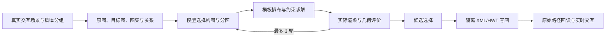

# 多模态反馈驱动的横屏布局重构

入口：`python multires.py live --port 8799`，右侧「布局重构」。原有流程和算法仍可独立运行。

## 设计补充

竖屏转横屏需要改变组之间的拓扑关系，单纯缩放或始终保留原来的上下顺序，会把时间、卡片挤得很小。采用三层方案：

1. **模型规划构图。** 输入原图、当前横屏图、带 ID 的组件图集、布局 JSON 和关系。输出模板、分区、组次序与理由；所有可移动组必须完整分配。
2. **代码求解几何。** 先按模板分区放置组，再使用 Kiwi 投影至可行位置。图片、文字、热区保持组内统一变换。
3. **反馈实际结果。** 渲染求解后的结果，将分数、拒绝原因和可用诊断图交回模型。模型可以选择已见到的安全候选，或提出新的构图。最后写回隔离项目并回放原始交互路径。



不将每一帧动画交给模型。选择有意义的交互场景，沿用已有组件身份、状态图、动画和媒体首帧处理；兼容布局的场景可以传播，不兼容的场景保留原结果。

## 平板构图词表

以下 6 类是本项目的模板词表，不是华为锁屏的强制分类。

| 模板 ID | 构图 | 建议场景 |
| --- | --- | --- |
| `center-stage` | 中心主视觉 | 时间/人物/插画突出，内容较少 |
| `hero-support` | 左右主辅 | 一侧时间或主视觉，另一侧天气、音乐等控件 |
| `triptych` | 三分区 | 超宽画布，中心主视觉与两侧辅助信息 |
| `card-grid` | 卡片网格 | 多个已有的小组件，按组重排为栅格 |
| `hero-dock` | 主视觉加底栏 | 上部视觉为主，底部已有快捷控件横向排列 |
| `side-panel` | 侧边设置面板 | 已经通过真实交互打开的设置或详情场景 |

分区只安排当前存在且可见的组。`side-panel` 不会自动打开隐藏弹窗，网格不会复制原脚本没有的卡片。分区内部根据组的完整资源/热区范围选择网格列数，保持等比；不只按可见图案大小计算空间。

参考：[华为多设备响应式与自适应布局](https://developer.huawei.com/consumer/cn/best-practices/multidevice/)支持按窗口形态调整排布；[HarmonyOS 设计案例](https://developer.huawei.com/consumer/cn/design)包含挪移、分栏和侧边面板思路。[Material canonical layouts](https://developer.android.com/develop/adaptive-apps/guides/canonical-layouts)提供列表详情、辅助面板与内容网格的参考。锁屏中的构图还需保留主题主视觉与留白，不能照搬应用导航结构。

## 关系优先级

| 关系 | 重构策略 |
| --- | --- |
| 变量、显隐、触发器、资源身份、XML 层级 | 禁止模型修改，原有写回保护继续执行 |
| 组内几何、图片与热区绑定 | 刚性等比变换 |
| 稳定可见资源的画布边界 | 必须满足，包含外框外的跟随资源 |
| 原有角落快捷键 | 按原角落和随资源缩放的边距保留 |
| 显式关系与组件最小/最大尺寸 | 保留优先级，不能由模型降级 |
| 跨组旧位置、顺序、间距 | 弱偏好，可被新构图改变 |
| 原本不相交的资源 | 追加资源级分离约束，最多 3 次求解修正 |
| 位图字库和共享动画尺寸 | 沿用导出器的跨状态限制，不能单场景偷偷改尺寸 |

显式复杂容器或不能安全编译的显式布局会拒绝自动重构，不能静默删除。用户可通过自定义求解器扩展这些场景。屏幕级居中在重构中可以变为分区内居中；组内时间/日期等内部结构仍保持整体。

## 实时预览中使用

1. 启动 `live`，导入主题包。
2. 打开「布局重构」，点击「分析当前主题」，或连接已有 `scenes/project.json`。自动分析最多 24 个状态、深度 4；已有缓存不重复提取脚本。
3. 选择横屏目标与交互场景。按行为变量推荐的场景只是代表场景，需要核对原始图，不能将当前动画帧直接当作新场景。
4. 选择离线规则或已配置的模型。离线模式最多比较 3 种模板；手动选模板时只生成该模板。
5. 查看实际渲染对比、拒绝原因与报告。只有导出和脚本回读通过的包，才能「载入候选并交互」。候选从脚本初始场景开始，可继续点按、滑动、拖动；「返回原主题」恢复原会话。

模型工作在后台任务中执行，不占用实时手势锁；同一服务一次只运行一个分析/重构任务。新请求与原始场景目录隔离，保存输入摘要、建议、候选图、几何、回读证据及拒绝案例。

## OpenAI 兼容模型配置

复制 `configs/layout-vlm.example.json`，将 `base_url` 和 `model` 改为实际服务信息。服务需支持 `POST /v1/chat/completions`、`image_url` 图片内容以及 JSON 文本输出；可使用本机 vLLM、远程服务或其他兼容实现。

```powershell
python multires.py live --port 8799 --vlm-config configs/my-layout-vlm.json
```

如需鉴权，把 `api_key_env` 改为环境变量名，例如 `LAYOUT_VLM_API_KEY`，在启动进程前设置该变量。密钥不写入浏览器配置、请求证据或报告。配置文件不支持明文密钥字段。

`json_mode` 只在服务支持 `response_format: json_object` 时启用。超时、输出截断、未知 ID、遗漏组、伪造摘要或试图修改受保护关系都会保留错误记录，不冒充离线模型成功。调用会发送已展示的主题图与布局信息到用户配置的服务；不会自动下载模型或进行训练。

## 命令行与接口

```powershell
python multires.py tools layout-reconstruct templates
python multires.py tools layout-reconstruct prepare theme/adaptation/项目/scenes/project.json `
  --target tablet-mock-16-10-landscape --state state-000 --out artifacts/reconstruction/my-run
python multires.py tools layout-reconstruct run artifacts/reconstruction/my-run/request.json `
  --config configs/my-layout-vlm.json --rounds 2
```

省略 `--config` 使用明确标记的离线建议器。`--advice advice.json` 可导入建议，`--template hero-dock` 指定离线模板，`--no-package` 只求解和预览。每次尝试请使用新的输出目录，以保存可审计证据。

建议格式：

```json
{
  "schema": "layout-reconstruction-advice/1",
  "inputDigest": "request.json 中的摘要",
  "candidates": [{
    "template": "hero-support",
    "confidence": 0.9,
    "rationale": "主视觉与控件分区，保留底部快捷入口",
    "groups": [{"id": "g0", "zone": "main", "order": 0}],
    "relations": []
  }]
}
```

`groups` 必须列出请求中全部可移动组各一次，示例仅展示格式。反馈轮可返回 `preferredCandidate`（已经反馈过实际渲染且通过几何检查的候选 ID 或 `baseline`）及 `reviewReason`。不能选择未提供画面的候选。

Python 替换接口：

```python
from multires_app.reconstruction.workflow import run
run(".../request.json", provider=my_model, solver=my_solver, evaluator=my_evaluator)
# provider(request, images, feedback) -> 建议 JSON
# solver(project, catalog, request, matches, advice, relations, attempt) -> (组件框列表, 求解证据)
# evaluator(project, target, state, catalog) -> score / outsideResources / newOverlapPairs / review 等指标
```

`solver` 输出仍经过独立的几何、跨场景、脚本结构及原始路径回读检查。替换算法不需要重新提取主题脚本。

## 边界与验证

- 几何评分只衡量尺寸、平衡、覆盖和新相交，不是人工审美标签；模型可对安全候选作视觉选择，并保留理由。
- 当前使用离线解释器图像；文字宽度估算、原生字体、特效与缺失资源仍影响可信度，不等于真机截图。
- 一轮最多 3 个候选、最多 3 轮。模型图集最多展示 27 组；超过预算会标记需要复核。
- 单个代表场景只传播到兼容布局；复杂的跨场景位图字库缩放仍受导出器约束。不能宣称一次选择覆盖整个主题全部交互。
- 本轮验证记录见 `docs/reports/LAYOUT_RECONSTRUCTION_MVP.md`；真实服务地址未配置时，不能把离线流程结果称为真实模型效果。
