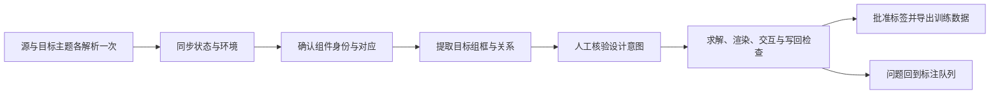

# 主题布局数据集构建与标注方案

调研日期：2026-10-20。本文结合 UI 数据集的一手论文、官方数据说明及本项目源码整理。标为“建议新增”的内容是设计方案，不表示已实现。

## 一、先确定数据集要教会模型什么

目标任务：**保留主题身份、资源和交互逻辑，根据目标画布与设计约束，输出可以执行的新布局。**

建议分别管理四类数据：

| 数据类别 | 主要内容 | 作用 |
|---|---|---|
| 脚本事实库 | 节点、表达式、资源、状态、运行时几何、手势轨迹 | 可追溯的底层证据 |
| 界面理解标注 | 元素功能、组件归属、场景意图、关系 | 让模型理解布局中的对象 |
| 适配配对数据 | 源形态、目标形态、组件对应、目标组框 | 主任务的监督信号 |
| 评价与修正数据 | 错误区域、错误类型、人工修改、候选偏好 | 定位 badcase，后续训练评价器 |

同一份脚本事实可以派生多种训练任务。界面描述、组件识别、布局生成和候选评价需要各自的任务定义与导出器，不能把它们全部当作同一种“布局正确答案”。

本项目真实包实验中，12 条样本有 8 条模型输出合规，其中 7 条复制了输入组框；输入本身来自规则算法。这是需要改善监督设计的证据，尚不能说明模型具备独立重排能力。详见 [真实主题实验记录](../reports/REAL_THEME_MVP_RESULTS.md)。

## 二、UI 领域的哪些做法值得借鉴

以下第三、四列是结合本项目提出的设计建议。

| 数据集 / 研究 | 原研究的监督方式 | 本项目可借鉴 | 使用边界 |
|---|---|---|---|
| [RICO](https://www.interactionmining.org/archive/rico) / [RICO Semantics](https://github.com/google-research-datasets/rico_semantics) | 截图、界面层级、交互轨迹；补充图标功能和文字关联的人类标注 | 图像与结构共同保存；标注“提示文字对应哪个图标、按钮对应哪个视觉组件” | 不提供鸿蒙主题原生直板机→平板的目标配对 |
| [CLAY](https://arxiv.org/html/2201.04100v2) | 用截图核对层级中的对象，清理视觉无对应对象并标注类型；对验证/测试标签进行多人核验 | 先检查图像与框是否一致，再标语义；测试集加强复核 | 主题中的隐藏节点、热区、动画节点不能据此从脚本中删除 |
| [Screen2Words](https://github.com/google-research-datasets/screen2words) | 对完整界面的功能进行文本概括 | 补充“这是锁屏、设置面板还是样式选择页”的场景标签 | 场景描述不能代替目标坐标监督 |
| [WebUI](https://uimodeling.github.io/) | 同时采集截图、可访问性结构、布局及样式；按网站域名划分数据 | 多设备采集、结构与图像同步、同主题家族整体划分 | 网页组件和主题装饰、景深叠层有领域差异 |
| [Android in the Wild](https://research.google/pubs/android-in-the-wild-a-large-scale-dataset-for-android-device-control/) | 保存任务、连续界面和实际手势演示 | 用“状态→动作→新状态”记录连续操作，保存前置状态 | 动作预测与布局适配是两个任务 |
| [PosterLayout](https://openaccess.thecvf.com/content/CVPR2023/html/Hsu_PosterLayout_A_New_Benchmark_and_Approach_for_Content-Aware_Visual-Textual_Presentation_CVPR_2023_paper.html) | 基于有内容的画布进行视觉文字布局，包含内容相关评价 | 对壁纸主体、脸部、留白和文字可读区域做标注 | 海报没有锁屏热区和交互状态，不能直接替代主题数据 |
| [UICrit](https://github.com/google-research-datasets/uicrit/blob/main/README.md) | 设计评价、对应问题区域、设计质量评分，记录反馈来源 | 记录“哪里有问题、为什么、怎样修复”，再收集 A/B 偏好 | 评分和评论不等于唯一正确布局；当前公开说明区分人类与模型评论来源 |
| [ReDeCheck](https://github.com/redecheck/redecheck) | 跨视口提取布局并检测重叠、越界等问题 | 标注相对关系、布局变化区间、断点附近失败 | 它是测试方法，不能直接作为设计师目标布局数据 |

优先借鉴这些项目的标注组织和质检方法。外部数据可以用于辅助界面理解或制定规范；主任务的训练与验收应以本领域的适配配对为准。实际纳入外部数据时，记录数据版本、原始来源和使用条款，不把不同来源默认为同一授权。

## 三、样本单位：一次有语义的状态适配

### 3.1 三种记录

1. **观测记录**：某主题、某设备、某交互状态、某时间相位的一帧图像与布局。
2. **适配样本**：源观测 + 目标设备 + 可选初始目标布局 + 目标布局标签 + 源目标对应关系。
3. **交互边**：前置状态 + 实际手势 + 触发对象 + 后置状态 + 状态变化。

建议给样本保存以下上下文：

```text
theme_family_id / theme_version / scene_key / style_variant
source_device / target_device / orientation / safe_region
interaction_trace / state_controls / environment_snapshot
reference_frame / animation_phase / layout_family_id
source_hash / parser_version / renderer_version / annotation_version
```

原生两种形态的 `state-001` 不一定是同一个场景。需要核对场景用途、样式、弹层、关键状态值及资源角色，再确认配对。

### 3.2 去重原则

- 时间从 00:41 变成 00:42、动画相邻帧或纯颜色变化，不应机械扩成许多独立布局样本。
- 显示设置面板、改变组件大小、改变样式导致分组变化，应保留独立状态。
- 用“组件身份 + 可见对象集合 + 几何/关系 + 布局变化类型”判断布局家族，图像相似度辅助人工检查。
- 不只比较像素：两张相似图片可能有不同点击热区；两张不同壁纸也可能属于相同模板。

## 四、三层核心标签与两类补充记录

### 4.1 核心标签

| 层级 | 标什么 | 自动获取 | 人工重点 |
|---|---|---|---|
| 元素层 | 原节点、资源、类型、几何框、可见框、热区、可见状态、时间相位 | 节点/资源/表达式/运行时框/触发条件 | 框图错配、缺失图片、错误语义、真实视觉边界 |
| 组件语义层 | 时间组、日期组、相机组、设置面板；成员、视觉与热区绑定、跨场景身份 | 脚本层级、变量依赖、已有组件推断 | 分组是否合理；哪些元素一起移动缩放；对应哪个触发区 |
| 场景意图层 | 锁屏/设置/样式页；居中、贴边、间距、顺序、主体避让；布局模式 | 当前布局关系、状态路径、画布配置 | 关系该保持还是改变；何时整体/局部重排，何时弹层或复用 |

组件语义应允许主角色与多个依赖共存。例如一个元素同时显示小时和分钟，不能因为先匹配到 `hour` 就丢失 `minute`。`Image` 是实现类型，不直接说明它是背景、时间数字还是按钮；视频也不必然是背景。

当前 `annotations.py` 的若干置信值是规则设定值，不是校准过的正确概率。建议另外记录证据类型和审核状态，人工审核前不把高规则分当作真值。

### 4.2 两类补充记录

- **交互与映射**：进入此场景的动作、连续操作路径、状态变量；原生双形态的元素/组件对应、拆分或合并关系。
- **质量与反馈**：渲染完整性、标签来源、批准/拒绝、问题区域、错误原因、修正动作、候选偏好。

不要求每个人工任务填写所有字段。原始证据自动缓存；人工优先处理不确定项及影响布局的意图。

### 4.3 四种框分开保存

| 框 | 含义 | 用途 |
|---|---|---|
| 几何框 `script_bbox` | 原表达式在指定状态/时刻求值后的几何范围；原表达式另外保留 | 求解与写回 |
| 可见框 `visible_bbox` | 图片透明区域、文字或其他可见内容实际覆盖范围 | 视觉居中、间距、遮挡 |
| 热区 `hit_bbox` | 可触发交互的区域 | 点击可达性与对应关系 |
| 屏内可见部分 `clipped_bbox` | 与画布/裁剪区相交后的区域 | 可见性核验 |

当前已有前两种框的基础字段；热区、裁剪/遮挡证据尚未作为统一标注字段完整导出。文字、裁剪图片等无法可靠测量可见框时，保留未知及原因。

“当前帧没有显示”也应分类：隐藏、透明、被遮挡、处于屏外过渡、缺资源、渲染器不支持。保留完整脚本与状态模型，只为不同训练任务选择合适的可见子集。

### 4.4 关系要说明参照物与证据

建议把关系保存为可计算记录：

```json
{
  "type": "center_x",
  "subject": "clock_main",
  "reference": "target_safe_area",
  "scope": "scene.locked",
  "policy": "preserve",
  "strength": "required",
  "origin": "human_confirmed",
  "evidence": "四个时间数字与分隔符共同形成居中的时间组"
}
```

这是建议的关系标注格式，当前标注导入器尚不能直接消费它。还应覆盖 `left/bottom attachment`、`above`、`align_center_y`、`equal_gap`、`min_gap_y`、`same_scale`、`avoid_overlap`、`allow_overlap`、`visual_hit_binding` 等。

居中可能是相对画布、安全区、容器或另一组件，不能省略参照物。贴角需要同时表达两个轴。日期与时间原本不重叠，应保留可见间距；景深人物与时间原本有意交叠，应记录允许交叠。规则推断的关系先保留为待确认的偏好。

## 五、真实双形态：先确认对应，再提取目标

推荐流程：



1. 固定时间、日期、天气、样式选择等上下文，保存环境快照；系统模拟值明确标注为模拟。
2. 确认两边是相同用途和状态的场景，不根据相近位置强行对应。
3. 对时间、日期、快捷工具等确认逻辑身份，再映射原生节点。两个脚本的 XPath 不要求相同。
4. 身份确认后，从目标脚本缓存提取坐标，人工修正少数错配，不从零画完所有框。
5. 图片或脚本目标本身存在错误时，人工改进后的布局另存为版本；原目标证据保留。

当前 `pairs.py` 支持一个源组对应多个目标组，并检查目标组重复使用等歧义。但 `multires-layout/1` 只执行源根组的位置与统一缩放，不能表达任意组内拆分、元素重新排序或新增节点。

如果原生平板版把同一时间组拆成两个独立排列，仅取包围框不足以还原设计。首轮先选择源目标可用同样刚性组表示的配对；此类拓扑变化另入队列，后续通过版本化的元素级/容器级执行协议支持。

## 六、标签来源与质量分开管理

| 目标来源 | 可用于什么 | 应记录 |
|---|---|---|
| 人工确认的原生双形态 | 主任务训练、独立测试 | 目标包版本、状态对应、组件映射、审核者 |
| 人工重排并验证 | 主任务训练、独立测试 | 修改前后、意图、适配规则、交互与写回结果 |
| 算法生成的目标 | 弱监督、规则蒸馏、候选参考 | 算法版本及参数；不是自动的人类真值 |
| 明确构造的扰动与修复 | 工程验证、可控修复任务 | 干净参考来源、扰动种子、范围与操作类型 |
| 模型生成但未审核 | 候选池或待标注队列 | 模型版本、提示、原文及失败原因 |

人工可以批准原本已正确的规则候选，但应记录“已审核、无需改变”；不把批量自动点击批准当成设计师独立真值。

再分别保存 `render_status`、`mapping_status`、`target_review_status`、`interaction_status`、`writeback_status`。这能区分“目标标签正确但渲染缺照片”和“图片完整但标签未审核”，比单一综合分更利于筛选。

叠峰的外部用户照片及天气值缺失，应保持缺失原因。首轮继续采用现有默认排除策略；后续若引入区域屏蔽或模拟环境，需要单独设计并验证，当前训练入口尚未实现局部损失屏蔽。

## 七、一条样本实际怎样标

建议人工工作顺序：

1. **确认场景与渲染**：源图、目标参考、框及交互相位是否对应；缺资源直接标记。
2. **确认组件组**：时间数字、分隔符、日期、按钮图标和热区是否正确关联。
3. **确认源目标身份**：一对一或合并映射；歧义先挂起。
4. **确认关键关系**：居中、四边/角落、纵向间距、允许交叠、主体避让、公共组件。
5. **确认目标组框**：优先使用原生目标缓存；必要时调整并记录原因。
6. **执行检查**：图像与 JSON 同步、组 ID 完整、约束、跨场景一致、交互可达、XML 审计。
7. **复核并批准**：训练集可抽查；独立测试集建议全部双人复核，冲突由第三人或设计负责人裁决。

先用少量样本校准标注员对“视觉居中、合理间距、可接受交叠”的理解。衡量标签一致率、映射一致率和目标关系冲突；存在多个合理布局时保留替代方案，不用平均两个人的框制造新目标。

每条批注建议包含：问题区域、类型、预期标准、当前差距、修正方式、来源。候选 A/B 排序可使用“选 A / 选 B / 都可 / 都不可 / 无法判断”，并记录理由。

### 标注工具怎样选择

建议继续以项目现有预览和缓存作为主题标注的主入口。它能保留节点身份、状态路径和布局写回上下文；泛用画框工具没有这些项目语义，需要导入/导出适配器。

| 入口 | 适合的任务 | 接入本项目时保留什么 |
|---|---|---|
| 现有主题标注页 | 组件组审核、目标组框、源目标对照；后续增加关系与身份映射 | 原节点 ID、状态、组件身份、目标设备、请求版本 |
| [Label Studio](https://labelstud.io/guide/labeling) | 框、语义及区域之间的关联；例如说明文字与相机图标、壁纸保护区 | 区域 ID 与主题节点的映射；通过转换器回写独立标注覆盖 |
| [CVAT](https://docs.cvat.ai/docs/manual/basics/vocabulary/) | 必须额外标注的视频主体或跨帧对象轨迹，使用关键帧与插值 | 媒体 ID、时间戳、对象身份、关键帧标记 |

Label Studio 的区域/关联数据结构见 [Task Format](https://labelstud.io/guide/task_format)。这些工具的数据不会自动变成本项目的布局标签，转换和身份校验是建议补充项。

序列帧或视频如果只是整个资源按首帧共同平移缩放，标注参考帧和资源身份即可，无需逐帧画框。只有主体内容随时间变化、需要保护主体区域等额外目标时，才增加关键帧标注；线性插值不能代替原动画时间线和脚本运动曲线。

## 八、训练任务怎么设计，避免只会复制输入

### 8.1 任务 A：跨形态适配

输入：源渲染图、源结构及角色、目标画布与安全区、必要约束。若保留当前执行协议需要目标初始组框，采用明确记录的简单初始化，并与规则算法初始化分开比较。

输出：人工确认的目标组框。

目标参考图留在审核与评价侧。源图对应源坐标，初始目标布局对应目标坐标，输入中明确标记两种坐标系。当前 `dataset.build` 会把规则算法结果填到 `inputLayout.groups`；任务 A 的独立初始化和导出路径是建议补充项。

### 8.2 任务 B：已有布局修正

输入：源图、当前目标渲染图、与当前目标图同步的布局 JSON、目标约束。

输出：人工改好的布局 JSON。

训练样本覆盖垂直挤压、时间日期重叠、角落漂移、未居中、弹层比例、未保持组内等比、壁纸主体遮挡等错误。同时保留少量确实无需修改的正确布局，避免模型为了改变而破坏设计。

合成错误应以真实错误类型为依据，保存干净参考与扰动操作。原图不改、JSON 被改时，不能把原图称为“当前目标渲染”；应重新渲染扰动后的布局。

### 8.3 任务 C：布局评价

输入：源设计意图与候选布局。

输出：问题区域、类型、理由及人工偏好。这个任务对应未来评价器或排序器，和输出组框的 SFT 分开导出。

首轮优先做好 A/B 中一个主任务。现有“源图 + 当前目标 JSON”的协议可以作为基础；从单张源图改成双图时，要保持训练与推理的图片数量、顺序和坐标定义一致。

## 九、数据规模与采样建议

下面是建议的试点预算，不是保证模型有效的数据量。

### 阶段 1：已有两套包，先校准规范

- 直接使用当前 12 条缓存样本，核对组件语义、关系、渲染和框。
- 优先处理叠峰交互后遗漏组、初升横屏局部变化及纵向间距案例。
- 目标资源不完整的样本先进入修复队列。没有原生平板包时，由人工制作目标，明确来源。
- 这两套已用于反复调试，不再作为下一轮全新泛化结论的独立测试集。

### 阶段 2：少量主题家族的真实配对

- 一个可操作预算是 20 个不同主题家族，每家族 3 个代表场景 × 2 个方向，约 120 条高质量适配对。
- 每个家族需要源与目标设计，两种原生形态可能是同一包的变体，也可能在两份包中；数据规模按主题家族和独立适配对计算，不按 HWT 文件数计算。
- 可按家族规划 12/4/4 的训练/验证/测试划分；先冻结划分再生成增强数据。
- 实际数量由主题多样性、目标可表达性、标注一致性和试验学习曲线决定。两个 32GB GPU 不会消除标签质量不足的问题。
- 不必为每个状态都制作目标：优先整体重排、局部重排、弹层、不同样式和断点附近变化；纯复用状态保存关系即可。

同作者模板、换皮、重复资源及同一原包变体应尽量归入同家族。可联合源脚本/资源哈希、结构相似度、图像相似度产生候选，再人工确认；不能只按文件名或单帧截图划分。

### 阶段 3：根据错误选择下一批标注

按“未覆盖的布局类型、渲染/映射不确定、规则与模型分歧、人工改动大、跨场景关系失败”排序，再加多样性去重和一部分随机抽样。不要只追逐自动评分低的样本，因为评分器也有盲区。

## 十、验证模型是否真的学到了布局

同一批测试样本上比较：简单初始化、原规则算法、未微调底座、LoRA 原始输出、LoRA 经约束结果。比较时保持任务输入与目标定义一致。

| 检查维度 | 建议记录 |
|---|---|
| 可执行性 | Schema 合规、完整组 ID、有限数值、宽高合法 |
| 设计保持 | 视觉居中、边缘/角落、纵横间距、等比、公共组件、可接受交叠 |
| 目标接近度 | 对人工目标的坐标误差与关系正确率；不要把 MAE 当唯一设计标准 |
| 交互保持 | 连续操作可达、热区对应、隐藏元素出现时机、样式切换 |
| 真正编辑能力 | 在“确实需要修改”子集上的有效修正率、复制输入率、错误修改率 |
| 求解器贡献 | 分别评价原始提案和投影后的结果，记录投影幅度 |
| 回退 | 缺失预测、无效预测、正常复用分别计数；回退成功不能计成模型成功 |
| 人工评价 | 对未训练主题做盲评，允许多个合理目标与“都不可接受” |
| 响应式稳定性 | 横竖屏、宽高变化、已知断点及附近样本，记录未采样区间 |

测试集以主题家族为统计单元报告结果；若做置信区间，也按主题而非相邻帧重采样。先声明验收规则，再看测试结果，避免反复用同一测试集选模型。

原本正确的布局保持不变是正确行为，所以复制率只应在“需要修改”的子集上用于判断能力。与人工目标存在几何差异的布局，也可能满足设计约束，需要结合关系评价和人工偏好。

## 十一、项目中可以复用与需要补充的能力

| 项目模块 | 当前可复用 | 建议补充 |
|---|---|---|
| `learning/dataset.py` | 持久缓存、状态去重、主题划分、原始/人工标签分开、SFT 导出 | 不同训练任务的输入初始化、家族近重复审查、关系/映射覆盖导出 |
| `learning/annotations.py` | 脚本属性、运行时实例、资源、初步语义、组和关系 | 多标签语义、统一热区、可见/遮挡状态、字段级证据 |
| `learning/space.py` | 网格占用与对比度留白候选 | 壁纸主体/人脸/文字可读区域的人工确认；现有算法不是语义显著性模型 |
| `learning/pairs.py` | 缓存之间的原生形态配对导入、对应确认与歧义拒绝 | 可视化映射工具、统一场景身份、超出刚性组的配对队列 |
| `learning/review.html` | 图像与框、元素/组语义、场景意图、组框编辑 | 组成员/关系编辑、映射确认、问题区域、多人复核与分歧裁决 |
| `learning/catalog.py` | 分页、批量写入、追加记录与乐观版本检查 | 分配标注任务、复核角色、仲裁状态、各字段审核进度 |
| `learning/quality.py` | 缺失统计和基础质量分级 | 分开管理来源、渲染、映射、目标审核与执行状态 |
| `learning/contract.py` / `algorithm.py` | 严格组框输出、模型替换、软提案进入原约束求解器 | 先维持 v1；有足够真实拆分案例后设计 v2 容器/元素操作 |
| `evaluation/` | 几何、居中/边缘、关系、响应式抽样、候选门禁 | 人工真值评价、按编辑需求分层、偏好评价与跨主题汇总 |

当前人工覆盖接口只接收元素语义、组语义和场景意图，以及目标组框；尚不支持直接写入组成员重构、关系编辑或偏好标签。上表的扩展项需要对应 Schema、页面、校验及导出器一起实现。

## 十二、建议的下一步顺序

**P0：先建立可信目标。** 用 12 条现有样本完成一轮人工标注试点，确定语义词表、组边界、关键关系及审核规范；补齐真实平板目标或人工目标。标注不清楚的样本挂起。

**P1：让界面支持关键人工操作。** 优先增加源目标对应确认、组件成员与关系编辑、质量分项审核。保留现有缓存与追加日志，不改原始脚本。

**P2：完善主任务导出与独立评价。** 区分源到目标适配、已有布局修正；建立需要修改/无需修改子集，加入复制输入检查，按主题家族冻结测试。

**P3：再扩充数据与模型。** 用少量真实配对比较规则、底座、LoRA 和约束后结果，根据学习曲线与真实 badcase 选择下一批标注。

标注和训练导出均可继续复用缓存。解释器语义发生修正或要探索新的交互时，应记录版本并重放相关状态，必要时更新解析缓存；“不重复提取”不等于永远使用过期事实。

## 参考入口

上述来源均为项目官网、作者论文或官方仓库，未把第三方整理的同名数据集与原研究混用。

- [现有数据流水线](DATA_PIPELINE_PLAN.md)
- [现有接口审计](IMPLEMENTATION_AUDIT.md)
- [Qwen MVP 使用说明](QWEN_LAYOUT_MVP.md)
- [真实主题实验记录](../reports/REAL_THEME_MVP_RESULTS.md)
