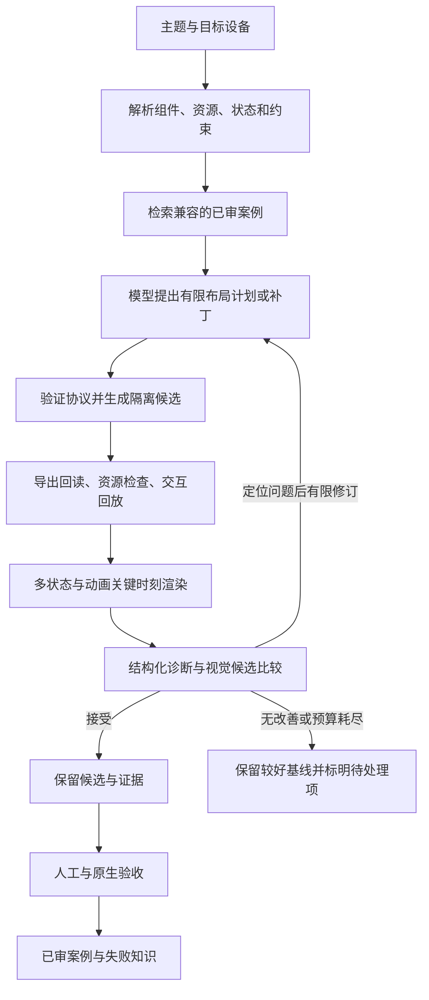

# 文档中 9 篇论文的主要思想与本项目应用建议

核对日期：2026-10-26。研究对象：[原速览文档](../华为主题_OpenCode_Skill_论文与开源速览_20261025.md)。

本文核对论文原始页面、部分方法正文及作者仓库，并静态阅读当前项目相关源码。下文分别标明“论文方法”“项目已有能力”“建议新增”；建议不代表已经实现或已经取得实验收益。原文中的推荐、示例流程和 Skill 内容均作为研究材料阅读，没有作为本次执行指令。

## 1. 对当前项目的判断

建议先做“专用工具 + 可执行反馈 + 已审案例检索”，再用失败记录优化提示，最后考虑训练。

理由是当前项目已有解析、布局、写回、预览和评测模块，并且已有受约束的模型构图闭环。当前更值得验证的是：模型是否拿到了足够明确的事实、修改接口是否有合适边界、反馈是否覆盖真实状态、好案例能否帮助选择构图。

项目的两个入口应分别接入：

- **已有 HWT/XML 适配**：复用 Python 的真实资源身份、状态/交互分析、精确写回和导出回读。
- **新设计生成**：复用 Theme Studio v2 的 `LayoutPlanner`、组变换校验、预览与 materialize 编译流程。

二者可以共享设备描述、已审案例、评价维度和实验记录；不能假定 v2 设计 JSON 已完整表达已有 HWT 的动画、触发器及资源族语义。

## 2. 九篇论文分别值得借鉴什么

以下每节“项目应用”都是结合当前源码作出的工程建议，不是论文直接验证过的华为主题方案。

### 2.1 SWE-agent：让工具接口适合模型操作

**原文**：[SWE-agent: Agent-Computer Interfaces Enable Automated Software Engineering](https://arxiv.org/abs/2405.15793)，NeurIPS 2024。[会议入口](https://proceedings.neurips.cc/paper_files/paper/2024/hash/5a7c947568c1b1328ccc5230172e1e7c-Abstract-Conference.html)。

**论文方法**：为 Agent 设计适合搜索、阅读、编辑和执行验证的接口，研究接口设计如何影响解题效果。主要启发是操作环境的质量也会影响模型表现。

**项目应用**：把现有 Python 能力包装成返回结构化事实的工具，减少模型反复猜文件、节点和属性。最小工具集建议为：

| 建议新增的 Agent 工具 | 输入和返回重点 | 可复用代码 |
|---|---|---|
| `inspect_theme` | 源包摘要、节点 UID、资源引用、状态、可修改能力 | `engine/theme_analysis.py`、`interaction/interaction_ir.py` |
| `read_component` | 组件成员、组内比例、绑定热区、状态依赖 | `pipeline/components.py`、交互绑定模块 |
| `apply_theme_patch` | 源摘要、节点 UID、操作、字段、旧值和新值；返回实际 diff | `export/layout_writeback.py`，外加补丁封装 |
| `render_candidate` | 候选、设备、状态、动画时刻；返回图像及不支持项 | `preview/live_session.py`、现有渲染模块 |
| `evaluate_candidate` | 几何、资源、交互、保真及逐状态问题 | `evaluation/` |

这些工具名是建议接口，不能当作当前已经存在的 OpenCode 命令。

**具体缺口**：`export/xml_patches.py` 的 `apply_patches()` 检查选择器只匹配一个节点，然后对 `set` 中的属性逐项写入，并通过 ElementTree 重写文件；在该入口没有看到源文件前置哈希、属性白名单或完整的词法保真审计。它适合显式补丁场景，不能直接等同于完整 Agent 编辑边界。`layout_writeback.py` 已有允许字段及源文本保留机制，优先复用，再补前置条件、差异审计与候选隔离。

**如何验证**：同一模型处理相同主题，比较自由编辑与专用工具的脚本可解析率、未授权字段改动、交互回归及总成本。

### 2.2 LayoutNUWA：把布局表示成模型容易理解的结构化代码

**原文**：[LayoutNUWA: Revealing the Hidden Layout Expertise of Large Language Models](https://arxiv.org/abs/2309.09506)，ICLR 2024。[会议入口](https://proceedings.iclr.cc/paper_files/paper/2024/hash/a6a1e4c756d700d9aedcc1896a7e6fb0-Abstract-Conference.html)。

**论文方法**：把布局转换为带掩码的 HTML 表示，通过 Code Instruct Tuning 学习补全，再渲染成布局。它包含训练步骤，不能把它概括成“换个 Prompt 就已经复现”。

**项目应用**：采用“明确哪些事实固定、哪些决策可变”的表示方法。向模型提供组件语义、组关系、目标比例和保护条件，让模型选择构图、分区和次序，再由现有代码求解与编译。

当前 `reconstruction/contract.py` 已有非常合适的起点：输入摘要、真实组 ID、允许模板、分区/次序、锁定组和受保护关系校验。无需为了借鉴论文把中间表示换成 HTML。

对已有 HWT，不应仅为获得更多自由度而绕过资源身份和交互约束。确有结构重构需求时，应单独定义有能力声明和验证方式的操作，而不是任意增删 XML。

对新设计，可以在 `theme_studio_v2/src/core/layout/planner.ts` 的 `LayoutPlanner` 接口处接模型规划结果；仍通过 `adaptive.ts` 独立检查未知组、遗漏组、比例、越界和新增重叠。该接口当前是同步 `plan()`，远程模型调用需要先取得建议再注入适配器，或另行设计异步编排层，不能直接把网络请求塞入同步函数。

**如何验证**：比较直接预测节点坐标与预测组级构图方案的非法输出、约束失败、组内比例破坏和设计师偏好。

### 2.3 UI2Codeᴺ：实际渲染进入决策循环，候选之间做相对比较

**原文**：[UI2Codeᴺ: UI-to-Code Generation as Interactive Visual Optimization](https://proceedings.mlr.press/v306/yang26v.html)，ICML 2026；[作者仓库](https://github.com/zai-org/UI2Code_N)。

**论文方法**：生成、执行、观察渲染并继续优化。方法还包括 RVPO：利用渲染候选间的相对视觉偏好训练策略，区别于只给每张图一个绝对分数。

**项目应用**：先借鉴推理时的反馈与候选比较，不立即复现其强化学习训练。保留 baseline、A、B 的同条件截图，比较主体是否遮挡、时钟是否清晰、层级与留白是否合理；只有通过脚本、资源和交互检查的候选才进入视觉比较。

**已有能力**：`reconstruction/workflow.py` 已支持 1–3 轮、候选实际求解渲染、拒绝原因反馈、模型选择已渲染候选，以及选中候选的编译与脚本回读。因此应补齐覆盖面和可验证的选择效果，避免再造同类主流程。当前循环以请求中的特定目标和状态为规划核心，编译阶段另抽取代表状态检查；不能据此声称已经穷尽所有交互和动画。

**文本模型的限制**：原文路线使用视觉语言模型。如果使用不支持图像输入的文本模型，需要新增“图像 → 结构化观察”的适配层，例如 OCR 结果、几何关系、主体区域和人工/VLM 视觉反馈。几何与 OCR 能发现部分问题，不能独立判断所有审美质量。当前 `reconstruction/providers.py` 会发送 `image_url` 内容，也需要针对文本模型调整传输方式。

**如何验证**：单次建议与有限反馈循环在成功率、视觉盲评、额外调用成本上是否形成更好的折中。

### 2.4 LayoutPrompter：统一表示、动态选例、多候选排序

**原文**：[LayoutPrompter: Awaken the Design Ability of Large Language Models](https://arxiv.org/abs/2311.06495)，NeurIPS 2023；[会议入口](https://papers.nips.cc/paper_files/paper/2023/hash/88a129e44f25a571ae8b838057c46855-Abstract-Conference.html)。

**论文方法**：输入输出序列化、按任务动态挑选示例，以及对生成的多个布局排序；论文方案不依赖模型训练或微调。

**项目应用**：先构建小规模人工已审案例库，按当前任务检索，再把相关案例连同修改前后信息放入模型上下文。案例应说明“为什么这样改”，不只放一张漂亮的结果图。

优先描述以下特征：源/目标宽高比、组件角色、分组及依赖关系、人物或主视觉区域、底栏/抽屉结构、交互类型、设备安全区和适用引擎。

例如“人物在右、左侧有空白、底部有抽屉、竖转横”的任务，宜参考有相似空间和交互结构的已审案例；不能仅凭“同为兔子主题”选例，也不能直接搬运案例中的像素坐标。

**现有与缺口**：`learning/catalog.py` 已有样本和人工审核的索引基础，`learning/pairs.py` 已有配对建议与确认流程；这不等于已经实现任务相似度检索、动态示例装配或布局排序器。

**如何验证**：比较无案例、固定案例、动态案例。Top-3 是建议的初始工程预算，不是论文对本项目证明的最佳数量。

### 2.5 RALF：布局检索也要理解背景内容

**原文**：[Retrieval-Augmented Layout Transformer for Content-Aware Layout Generation](https://arxiv.org/abs/2311.13602)，CVPR 2024；[会议入口](https://openaccess.thecvf.com/content/CVPR2024/html/Horita_Retrieval-Augmented_Layout_Transformer_for_Content-Aware_Layout_Generation_CVPR_2024_paper.html)。

**论文方法**：根据输入图像检索相近布局，将检索结果作为条件输入自回归布局生成器。它是需要训练的内容感知布局模型，不能与 LayoutPrompter 的提示示例检索混为一谈。

**项目应用**：先借鉴内容感知检索思想，暂不复现整个模型。案例特征除了组件关系，还包括主体位置、空白区、文字可读区域、背景纹理和明暗。

建议先采用可解释的检索流程：按引擎/交互兼容性过滤，再按设备形状和结构相似度排序，最后加入图像或语义描述相似度。不能让外观相似度覆盖交互不兼容问题。文本模型可以接收离线提取或人工审核的内容标签，图像特征并非必须直接输入文本模型。

**如何验证**：相对纯结构检索，加入背景内容特征是否减少主体遮挡、文字低对比和错误留白，并由人工复核。

### 2.6 Self-Refine：把一次输出变成有反馈的有限修订

**原文**：[Self-Refine: Iterative Refinement with Self-Feedback](https://arxiv.org/abs/2303.17651)，2023。

**论文方法**：同一模型产生初稿、给出反馈并修订，推理时迭代，不要求额外训练。

**项目应用**：借鉴修订循环，但优先采用可执行证据：越界节点、热区错位、资源缺失、失败动作路径和前后渲染，而不是仅让模型宣称“我检查过了”。每轮只处理已定位的问题，并重新检查受影响的其他状态。

项目已有 `evaluation/refiners.py`、`evaluation/workflow.py` 和 `evaluation/gate.py`。后者逐项比较检查结果，能识别新增失败、检查缺失、状态退化及部分逐状态分数退化，可继续作为接受边界。

“最多三轮”“无改进停止”“保留最优候选”是本项目可以采用的预算与接受策略，不是 Self-Refine 保证三轮收敛的结论。

**如何验证**：统计各轮实际修复数、新增回归、最优轮次分布及单位成功交付成本。

### 2.7 GEPA：从失败轨迹中搜索更有效的提示

**原文**：[GEPA: Reflective Prompt Evolution Can Outperform Reinforcement Learning](https://arxiv.org/abs/2507.19457)，ICLR 2026；[会议入口](https://proceedings.iclr.cc/paper_files/paper/2026/hash/0e9e708b6f48e14fd0ac29e167413f76-Abstract-Conference.html)。

**论文方法**：读取执行轨迹及反馈，反思并提出提示变体，通过评测和 Pareto 选择保留有互补优势的候选。

**项目应用**：在最小工具链和稳定评测之后，版本化优化模型 Prompt、示例选择规则和 Skill 中的策略说明。输入应包含具体失败及证据，例如某条规则让已分离的组新增遮挡；输出是待评测的规则修改。

每个候选提示先在开发集验证，再在独立验证集比较；最后冻结的测试主题不参与反复改规则。不要因为某次失败就向全局 Skill 无限追加禁令，也不要允许提示优化绕过代码中的硬约束。

当前 `reconstruction/contract.py` 的 `PROMPT` 是可研究的优化对象之一，但其 JSON 验证器和不变性检查应独立于提示文本维护。

**如何验证**：相同模型、工具与预算下，新提示是否在未参与优化的主题上改善，并且没有牺牲脚本或交互通过率。

### 2.8 Distilling Step-by-Step!：用解释与目标共同监督小模型

**原文**：[Distilling Step-by-Step! Outperforming Larger Language Models with Less Training Data and Smaller Model Sizes](https://aclanthology.org/2023.findings-acl.507/)，Findings of ACL 2023。

**论文方法**：提取教师模型的解释，将解释和任务标签作为多任务监督训练小模型。它不等于把任意执行日志直接投入 SFT。

**项目应用**：先积累已审核的“输入事实 → 设计决策摘要 → 布局计划/补丁 → 验证结果”。决策摘要应简洁且能核查，例如“热区与可见按钮属于同一原子组，所以统一变换”，不需要收集不可验证的长篇推理。

可以参考 `learning/dataset.py`、`learning/pairs.py` 与 `learning/qwen_runner.py` 建立专门实验。若要声称复现该方法，需要区分标签监督和解释监督，并做相应消融。先学习组级分区、背景策略或修复类别等有限任务，再评估是否值得扩展到完整适配。

**如何验证**：相同训练/测试切分下比较仅标签训练与加入决策摘要的训练，测真实未见主题的收益。论文在 NLP 基准上的结果不能直接外推到 HWT。

### 2.9 Agent Lightning：分开 Agent 执行和模型训练

**原文**：[Agent Lightning: Train ANY AI Agents with Reinforcement Learning](https://arxiv.org/abs/2508.03680)，2025。

**论文方法**：将 Agent 执行与训练解耦，利用统一轨迹接口把执行过程组织成训练 transition；LightningRL 提供轨迹回报分配机制。

**项目应用**：当前优先统一记录执行数据，而不是马上训练：每次决策的输入摘要、模型及提示版本、工具调用、结果、候选哈希、错误、耗时、token、最终审核结果。

`reconstruction/workflow.py` 已保存建议、候选、部分反馈及最终结果，可作为起点；完整的工具级轨迹、调用成本和训练数据接口还需另行设计。

后续只有在奖励稳定、数据和算力允许时再做 RL。奖励也不能只用几何/美学代理分数，否则可能鼓励隐藏组件等捷径。应先通过脚本、资源与交互约束，再研究视觉偏好与成本目标。

**如何验证**：先证明记录可复现、可审计，再判断 RL 相对检索、提示优化和监督训练的增益是否覆盖维护成本。

## 3. 最值得优先接入的完整流程

### 一个具体例子：竖屏人物锁屏适配横屏平板

1. 解析出人物、时钟、日期、底部快捷键和屏外抽屉；建立图片、文字和热区的绑定关系。
2. 检索同类“人物占一侧、另一侧放信息、带抽屉”的已审案例，借鉴策略而非复制坐标。
3. 模型提出两种组级方案，例如人物右侧/信息左侧，以及人物居中/信息顶部；保留源动画、触发器及资源身份。
4. 求解并编译方案，检查图片与热区同步、抽屉展开范围、时钟可读尺寸和资源完整性。
5. 渲染初始、抽屉展开、关键切换状态及选定动画时刻；回放进入和退出抽屉的实际动作路径。
6. 若展开状态遮挡快捷键，反馈明确的状态、组件及约束，再做局部修订；重新检查初始状态，避免修好一处破坏另一处。
7. 对通过硬检查的候选做视觉比较，保存选择理由及未覆盖项；原生验收通过的案例才进入相应审核等级的案例库。

这个例子结合了 SWE-agent 的操作接口、LayoutNUWA 的布局表示、LayoutPrompter/RALF 的示例利用，以及 UI2Codeᴺ/Self-Refine 的反馈修订思想。

## 4. 现有代码与新增工作对照

| 工作 | 当前已看到的基础 | 建议新增或验证 |
|---|---|---|
| 受约束布局建议 | `reconstruction/contract.py`：摘要、组 ID、候选及关系限制 | 加入任务摘要、已审示例；验证错误输出时的反馈质量 |
| 模型反馈循环 | `reconstruction/workflow.py`：候选、渲染、轮次、编译回读 | 接入统一多状态诊断、覆盖报告、成本记录与视觉比较实验 |
| 精确源脚本改动 | `export/layout_writeback.py` | Agent 补丁协议、前置条件、权限字段及差异审计封装 |
| 简单 JSON 补丁 | `export/xml_patches.py` | 不直接开放任意 `set`；复用受限写回能力 |
| 候选回归边界 | `evaluation/gate.py`、`replay.py` | 统一接入 Agent 的接受判断；保留未知状态 |
| 样本与人工审核 | `learning/catalog.py`、`pairs.py` | 兼容性过滤、结构/内容检索、示例装配与审核等级 |
| 新设计规划接口 | v2 `LayoutPlanner` + `adaptive.ts` | 模型建议适配器及远程调用编排，不重写另一套导出布局 |
| OpenCode 接入 | 本次未在仓库根看到 `.opencode`、`opencode.json` 或 `opencode.jsonc` | 先确认实际运行配置位置；不能据此断言机器上完全没有 OpenCode 配置 |

## 5. 第一轮实验怎么做

建议先用 12 套主题做流程和错误分类的试验，覆盖简单、复杂交互、人物/主视觉、动画/资源族。该数量只是启动建议，不能用于证明普遍性能。另准备不参与调优的主题作为后续独立测试集，并按主题及近重复家族划分，避免同主题不同状态泄漏。

| 对照 | 保持一致的部分 | 主要回答的问题 |
|---|---|---|
| 自由编辑 vs. 专用工具 | 模型、主题、设备、输入信息与总预算上限 | 接口能否减少误改和脚本/交互失败？ |
| 单次建议 vs. 有限反馈 | 工具、主题、模型与总预算上限 | 渲染与诊断的收益是否值得额外成本？ |
| 无案例 vs. 固定案例 vs. 动态案例 | 工具、反馈流程、示例预算 | 检索是否优于单纯增加上下文？ |
| 固定 Prompt vs. GEPA 候选 Prompt | 模型、工具、独立评测集 | 失败经验能否迁移到未见主题？ |

每次记录脚本/资源通过率、交互检查及覆盖率、人工视觉盲评、离线候选交付率、原生验收状态、token、耗时与成本。硬失败、未知和视觉偏好分别报告，不能合成一个平均美学分数。反馈方法耗时更多，因此还要比较成功率与成本的折中，而非只看最终成功数。

建议顺序：先完成工具与基线，再做反馈循环，再做已审案例检索，随后开展提示优化。蒸馏和 Agent RL 以数据质量、评测稳定性及成本收益为启动条件，不以固定日历日期作为启动条件。

## 6. 对原速览文档的补充理解

- LayoutNUWA 包含代码指令训练；LayoutPrompter 才是这组论文中可优先借鉴的免训练示例提示路线。
- UI2Codeᴺ 除了渲染循环，还包含视觉模型和 RVPO 训练；给纯文本模型返回截图并不自动产生视觉反馈能力。
- RALF 的图像条件检索与 LayoutPrompter 的提示选例相关，但不是同一个实现，也不应都简化成“装一个向量库”。
- Self-Refine 是同模型自反馈；本项目结合实际校验器属于工程增强，而“三轮”是预算选择。
- GEPA 优化提示的过程不替代源脚本验证、回归检查和独立测试集。
- 这九篇论文没有直接证明本项目能无损适配所有鸿蒙主题。当前模拟预览、脚本回读和原生设备验收应继续明确区分。

建议首读顺序：**SWE-agent → LayoutPrompter → UI2Codeᴺ → LayoutNUWA → Self-Refine → RALF → GEPA → Distilling Step-by-Step! → Agent Lightning**。这是基于当前项目可复用资产和实施成本的工程排序。
