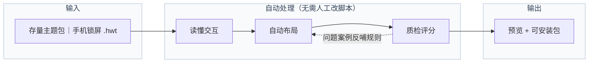

# 锁屏主题多分辨率适配 · 整体流程（Mermaid）

面向汇报的精简版流程，只有 5 步，不含技术细节。可直接粘贴到支持 Mermaid 的工具（语雀、飞书、Typora、GitHub、VS Code、mermaid.live）渲染。

> 标签刻意写成单行（用 `｜` 分隔主标题与说明）。Mermaid 11 会把 ` ` 当 HTML 过滤掉，写 ` ` 反而会连成一句，所以不要加换行符。

## 主流程

## 按阶段分组（同一件事，换一种讲法）

把 5 步收成「输入 → 自动处理 → 输出」三段，适合强调「中间不用人管」。

> 注：Mermaid 11 里 `style 子图ID fill:...` 对 subgraph 不生效（会保留默认浅黄底），给子图上色要用 `classDef` + `class`，上面的第二张图就是这么写的。

## 配套讲法

- **输入是什么**：已经上架的存量手机锁屏主题包，不用重新设计。
- **人要不要管**：前四步全自动，不需要逐套改脚本。
- **产出是什么**：一套能直接看的预览，加一个可安装的主题包。
- **质量怎么保证**：遮挡、超框这类问题自动检出，问题案例还会沉淀成布局规则，下一批直接受益。
- **一句话结论**：从「人工逐个改脚本」到「自动适配 + 自动质检」。

---

同一张图的图片版见 `docs/reports/PROJECT_FLOW_OVERVIEW.png`（1280×720，可直接拖进 PPT）与 `PROJECT_FLOW_OVERVIEW.svg`（矢量，可改字改色）。
