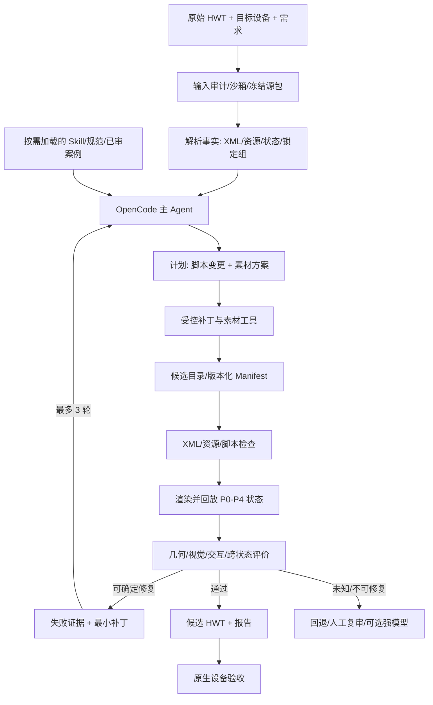

# 华为主题多分辨率适配：OpenCode + 文本大模型 + Skill 工程化路线图

> **团队研究/研发执行文档 · V1.0 · 2026-10-24**  
> **路线定位：方案二——AI 编程 Agent 直接生成/修改主题脚本与素材**  
> 目标仓库：`F:\multi-res`；建议入库位置：`docs/华为主题_OpenCode_Skill适配工程化路线图_20261024.md`  
> 目标读者：算法、Python/后端、前端/预览、测试、主题设计与项目负责人

## 0. 执行摘要：现在处于哪里、下一步做什么

**当前已知事实**：OpenCode 已接入文本大模型，完成了“给出主题适配请求 → 单次生成适配结果”的初步测试（来自本次需求描述）；尚未证明输出能够稳定通过完整脚本、素材、交互、视觉与真机验收。先前对 `F:\multi-res` 的读取已确认存在 HWT/XML 解析、交互探索、实时预览、XML 精确写回、反馈门禁、评测资产与约百套主题采集目录；**当前 OpenCode 配置文件、现有 Skill、最近一次实验成绩没有重新读取核实**，以下新模块和指标均是建议，不应视为已完成。

**一句话决策**：不要再把主要时间投入“给 DeepSeek 写更长的 Prompt，期待一次生成好看主题”。把现有 OpenCode 测试升级成 **具有专用工具、只改候选副本、可运行预览、可检查多状态、失败有限重试、可回退和可归因的主题适配 Agent**；等评测可用，再用案例检索、候选重排、Prompt 优化和知识蒸馏逐步拉近与更强模型的差距。

**建议优先级**：
1. **P0：跑通闭环**：输入主题 → 修改脚本/素材候选 → 实际渲染 → 确定性检查 → 局部修复 → 回归 → 候选 HWT。
2. **P0：固定评测集**：至少覆盖不同主题复杂度、设备宽高比、交互路径和资源类型；失败按根因标注。
3. **P1：Skill 与工具库**：把“规范+步骤+受控接口”做成可维护的领域资产。
4. **P1：优质案例检索 + 多候选排序**：在不训练 DeepSeek 的前提下提升成功率。
5. **P2：强模型离线教师 + GEPA/DSPy**：优化提示词、案例和策略，避免每单都调用贵模型。
6. **P3：微调/蒸馏/奖励训练**：只在已有可靠真值、可复现评测与合规授权时立项。

**重要边界**：本路线不依赖旧 `anchor_layout.py` 作为布局生成主流程；但可以复用原工程的脚本解释、交互抽帧、渲染、写回和验证能力。LLM 可以决定如何改变布局和素材，**不能绕开确定性校验或真机验收**。浏览器结果是候选验证，不代表在所有 HarmonyOS 版本下已通过原生测试。

---

## 1. 与方案一的区别及技术路线

| 维度 | 方案一：算法/约束布局主导 | 方案二：OpenCode + Skill 主导 |
|---|---|---|
| 决策者 | 布局算法、锚点和求解器 | LLM 规划与逐步编程修改 |
| 主输入 | 已解析元素/组 JSON、目标画布 | 原主题工程、XML、资源清单、渲染帧、设备 Profile、领域规范 |
| 主输出 | 重排后的布局坐标 | **脚本补丁 + 素材产物 + 资源映射 + 完整候选包 + 执行证据** |
| 能力优势 | 确定性、高吞吐、可解释 | 适合脚本结构差异、复杂设计意图与工具编排 |
| 失败形态 | 规则覆盖不足/构图僵化 | 幻觉属性、误改交互、素材失真、长链工具错误 |
| 共同基础 | 解析、回放、渲染、硬门禁、回滚 | 解析、回放、渲染、硬门禁、回滚 |

建议架构：



**执行契约**：模型只提交“拟采取的操作”和理由；具体操作由可信工具验证参数并执行。没有已核实主题规范就不允许凭空添加 XML 属性。任何一个阶段 FAIL 或 UNKNOWN 均不得被平均视觉得分掩盖。

---

## 2. 现有项目资产与可复用接口（根据先前源码导航）

| 目标能力 | 已确认的目录/代表文件 | 方案二应怎么接入 | 现阶段注意 |
|---|---|---|---|
| XML 读取与脚本语义 | `src/multires_app/engine/scene_engine.py`、`engine_capabilities.py` | `inspect_theme` / `read_nodes` | 引擎解释器不等于所有新版本原生规范 |
| 场景/交互事实 | `interaction/interaction_ir.py`、`interaction_semantics.py` | `list_states`、`replay_trace` | 状态探索未覆盖分支必须显示 UNKNOWN |
| 组件分组/场景分析 | `pipeline/scene_clusters.py`、`components.py` | 提供事实摘要，不强制按旧算法重排 | 分组可能误合并或误拆分 |
| XML 精确写回 | `export/layout_writeback.py`、`scene_export.py` | 实现 `apply_xml_patch` 的底层能力 | 原有字段边界之外的变更需新补丁/审计能力 |
| 浏览器/实时预览 | `preview/live_preview.py`、`interaction_server.py`、`scene_previewer.py` | `render_candidate` / `snapshot_state` | 浏览器与原生引擎结果可能不同 |
| 素材匹配 | `preview/reference_matching.py`、`target_layout.py` | 可作为辅助工具，不作为必经路径 | 外观匹配不能代替真实资源身份 |
| 质量检查/回归 | `evaluation/checks.py`、`gate.py`、`workflow.py` | `evaluate_candidate` / `compare_baseline` | 正确复用 `pass/fail/review/unknown` 语义 |
| 测评原料 | `eval/scorecard.json`、`eval/badcases.jsonl` | 选定困难集、记录坏例分布 | 历史评分不一定绑定当前候选哈希 |
| 主题样本 | `datasets/` 约 100 套采集、`theme/` 真实主题 | 分层抽样、建立 Approved Cases | 预览或程序生成候选**不自动等于人工设计真值** |
| Qwen 实验基础 | `learning/qwen_runner.py`、`learning/dataset.py`、`contract.py` | P3 蒸馏和训练可参考 | mock 改善不能宣称真实适配改善 |

**先执行差距审计**（进入 P0 前完成，避免重复造轮子）：

- [ ] 在真实仓库内确认 OpenCode 版本、`opencode.json`、`.opencode/skills/`、`.opencode/tools/`、已有模型及插件配置；**不要在文档中假定它们已存在**。
- [ ] 用 3 套真实主题复现当前单次生成：保存 Prompt、模型名称及版本、token/耗时、源包哈希、输出包、完整操作日志。
- [ ] 证明至少一个候选能被真实 XML 解释器加载、再写回、生成预览；若不能，先解决最小链路。
- [ ] 列出脚本允许修改的字段与需要独立实现的变更（新增节点、资源替换、触发器修改等），按目标 HarmonyOS 版本分级。

---

## 3. 分阶段路线图（建议 10 周；每阶段按验收结果推进）

> 下表是**研发顺序与工期估算**，不是交付承诺。若团队并行，可压缩周数；缺少原生验收资源则不能以浏览器通过替代上线验收。

| 阶段 | 周次 | 核心任务（必须按序） | 交付件 | 完成/退出门槛 | 优先级 |
|---|---|---|---|---|---|
| **M0. 建立基线** | W1 | 核对 OpenCode 现状；冻结测试主题/环境；保存当前一次性输出 | `baseline_runs/`、主题清单、失败分类 | 每条结果可重现、含输入输出哈希 | P0 |
| **M1. 受控脚本编辑** | W1–W2 | 主题解析工具、版本规范 Skill、补丁协议、候选沙箱、导出校验 | `inspect_theme`、`apply_xml_patch`、patch manifest | 允许修改字段 100% 由白名单审计；源包不变 | P0 |
| **M2. 素材加工最小集** | W2–W3 | 背景裁剪/铺展/扩边；资源引用映射、透明度/尺寸检查 | `transform_asset`、asset manifest | 生成素材可追溯、无丢失引用、支持回滚 | P0 |
| **M3. 渲染反馈闭环** | W3–W4 | OpenCode 调预览/多状态回放/评分；最多 3 轮定点修复 | `render/evaluate/repair`、单主题回归页 | 能在真实主题上发现并修复至少一类可复现错误；不静默通过 UNKNOWN | P0 |
| **M4. 固定评测与门禁** | W4–W5 | 主题级数据切分、硬条件、设计师盲评、跨设备矩阵 | v1 benchmark、报告仪表板 | 有 DeepSeek 原始 vs Agent 完整流程对照 | P0 |
| **M5. Skill 工程与案例检索** | W5–W7 | 规则拆分、Top-K 案例、失败知识库、动态组装上下文 | `skills/`、`approved_cases/`、case retriever | 相同评测集相对 M4 有可重复收益，P0 不退化 | P1 |
| **M6. 候选排序与预算优化** | W7–W8 | 2–3 候选、脚本约束筛选、渲染偏好排序、强模型兜底 | routing/ranking、成本报表 | 成功率、成本、时延三指标有可解释 Pareto 改善 | P1 |
| **M7. 强弱模型协同** | W8–W9 | 教师案例审核、GEPA/DSPy Prompt 优化、弱模型缺陷聚类 | prompt 版本集、可审轨迹集 | 独立测试集优于固定 Prompt 基线，不泄漏样本 | P2 |
| **M8. 上线准备与灰度** | W9–W10+ | 真机/官方工具验收、回滚、权限、监控、资源与许可证审查 | release checklist、灰度策略 | 有明确支持范围；FAIL/UNKNOWN 不自动发布 | P0/P1 |
| **M9. 训练路线（可选）** | 条件触发 | 有足够已审轨迹后做 SFT/偏好优化/Agent RL | 离线训练与评测报告 | 相比 M7 的收益大于训练/维护成本 | P3 |

### 各里程碑的具体任务与验收（建议开成可追踪 Ticket）

#### M0｜基线与现状检查

- [ ] **M0-01（算法/项目）**：明确可支持的第一个产品范围：例如传统 XML 锁屏、静态/简单交互、`1080×2400 → 2560×1600`；HarmonyOS 5+/6+ 能力另设兼容矩阵，不能无证据沿用旧脚本规则。
- [ ] **M0-02（工程）**：录制当前 OpenCode **实际**工具调用轨迹，而不仅是保存最终 XML；记录 source/target 资源文件数量和哈希。
- [ ] **M0-03（测试/设计）**：选 12 套试验主题：简单 4、中等 4、复杂 4；包括人物主体、装饰叠层、时间图片、动态/多触发器场景。
- [ ] **M0-04（测试）**：按“脚本可解析/资源可用/交互/视觉/真机待验”五类统计失败。发布基线表，不以某张成功截图代替通过率。
- **退出条件**：他人能够重跑同一主题并取得可比的证据包；记录未知项。

#### M1｜最小可控脚本适配工具链

- [ ] **M1-01（后端）**：建立主题只读副本与隔离工作目录：源包 `readonly`，所有候选写入唯一 run_id 下。
- [ ] **M1-02（后端）**：`inspect_theme(hwt)` 返回 XML 节点 ID、资源引用、图层顺序、状态依赖、目标引擎版本、允许修改字段；输出机器可读 JSON。
- [ ] **M1-03（算法/规则）**：维护 `spec_matrix`（引擎版本 × 标签/属性 × 校验方式 × 官方文档/真实验证来源）。不确定语义为 `unsupported/unknown`。
- [ ] **M1-04（后端）**：`apply_xml_patch` 采用节点定位 + 前置哈希 + 字段白名单 + 结构差异审计，禁止无边界整文件重写；脚本结构变更走单独高风险审批。
- [ ] **M1-05（测试）**：Round-trip：源主题读取 → 合法改动 → 导出 → 重新解析；校验未修改的节点 ID、触发器、动作、资源路径与顺序不意外变化。
- **退出条件**：在试验主题范围内，所有接受候选都能重新解析和审计；异常不会污染源包。

#### M2｜素材转换与资源清单

- [ ] **M2-01（图像/后端）**：实现 `asset_plan`：`reuse` / `crop` / `pad` / `resize` / `outpaint` / `segment` / `regenerate`，先选择低风险确定性操作。
- [ ] **M2-02（图像）**：背景优先等比覆盖或留白填充；保留透明图层和图片时钟的可见内容、字形与交互命中区相互绑定。
- [ ] **M2-03（后端）**：资源 manifest 包含 `source_hash`、`output_hash`、生成工具、参数、分辨率、alpha、版权/许可证状态与替换位置。
- [ ] **M2-04（质量）**：素材合法性检查：文件存在、格式、尺寸、色彩空间、alpha、像素极限、同名覆盖、未引用垃圾资源。
- [ ] **M2-05（设计）**：生成式扩图/分割只以可选流程接入；前景边缘、背景主体一致性、图标语义和时间文字必须人工或专项检查。
- **退出条件**：对可控样本可以同时交付 XML 与处理后的素材，不产生悬空引用；不覆盖旧素材。

#### M3｜从一次输出到反馈驱动

- [ ] **M3-01（后端）**：新增 `render_candidate`，输出源/目标截图、元素 bbox、资源可见性、图层顺序及可复现实验环境。
- [ ] **M3-02（交互）**：复用现有状态机，优先覆盖 `P0 基准 / P1 互斥状态 / P2 风险组合 / P3 固定时间电量 / P4 动画过渡`；外部手势和系统变量要可重播。
- [ ] **M3-03（评测）**：`evaluate_candidate` 输出标准化问题：`code`、`severity`、`status`、`affected_nodes`、`evidence`、`suggested_scope`。
- [ ] **M3-04（Agent）**：修复仅允许修改相关节点/素材；每轮重新评测全部已覆盖状态；拒绝新增失败、缺失规则或扩大 UNKNOWN 的候选。
- [ ] **M3-05（后端）**：最多三轮；无客观改善立即停止；记录 best-known-safe 候选和精确回滚点。
- **退出条件**：可展示**一次初稿失败 → 错误定位 → 补丁 → 重新渲染通过**的完整轨迹，而非“第二次随意重写碰巧好看”。

#### M4｜标准化质量门与评测集

- [ ] **M4-01（测试）**：按照主题家族/重复素材近邻做数据划分；同一个主题及其改色、分辨率衍生版不得跨 train/test。
- [ ] **M4-02（设计）**：对每套主题指定可接受视觉意图：主体、留白、中心、边缘、组件相对关系、合法遮挡和必要设计变化。
- [ ] **M4-03（评测）**：指标拆分：`structural_validity`、`resource_integrity`、`interaction_pass`、`geometry_pass`、`native_validation`、`designer_preference`。
- [ ] **M4-04（评测）**：几何规则既看重叠也看**重叠是否由原设计许可**；大面积背景与前景相交不能直接计错。
- [ ] **M4-05（工程）**：每次运行保存：输入哈希、模型和提示词/Skill 版本、工具版本、执行时长、调用/费用、候选数、完整分状态分数、拒绝原因。
- **退出条件**：所有对照组能在固定测试集独立复测；硬门禁与视觉偏好分别报告。

#### M5–M7｜弱模型增强工程

- [ ] **M5-01（算法）**：收集**已审核成功**的跨屏适配，按 `原布局/设备比例/背景类型/主体位置/交互复杂度` 建索引；源/目标成对保存。
- [ ] **M5-02（算法）**：比较 0-shot、固定 3 示例、动态 Top-3 检索；不把合成候选当金标准。
- [ ] **M5-03（算法）**：将坏例修复压缩成可执行 Skill 修订或工具测试用例；每条知识绑定适用条件与反例。
- [ ] **M6-01（算法）**：对困难场景生成 2–3 个不同修复候选；先硬约束过滤，再渲染，再做视觉/人工偏好排序。
- [ ] **M6-02（算法/成本）**：小模型优先执行；超过预算、连续失败、未知规范或失败类型不支持时停止或升级到人工/强模型。
- [ ] **M7-01（算法）**：用强模型在**离线**任务中帮助制定策略与诊断，人工审核后形成案例和 Skill；遵循模型供应商的数据/训练使用条款。
- [ ] **M7-02（算法）**：在冻结验证集上用 GEPA/DSPy 自动优化 Prompt/示例选择；只把验证受益版本入库，不对测试集反复调参。
- **退出条件**：提供逐主题 A/B 报告，证明工程增强来自哪一层，而非仅比较几张示意图。

#### M8–M9｜灰度与长期迭代

- [ ] **M8-01（平台）**：任务队列、超时、重试上限、并发上限、模型降级策略、日志脱敏、权限最小化、审计链。
- [ ] **M8-02（质量）**：按引擎/系统版本、设备横竖屏、主题类型公布 `支持/条件支持/不支持` 白名单。
- [ ] **M8-03（测试）**：真机/官方工具独立验收，不通过则回退；批量成功率分母必须包含失败与未覆盖。
- [ ] **M8-04（运维）**：灰度 5% → 20% → 50% 仅作为可选滚动策略，具体比例由实际风险、样本量和回滚能力决定。
- [ ] **M9-01（研究）**：仅当有数百至数千条**已审且覆盖不同主题家族**的有效轨迹、许可明确、GPU 预算合理时考虑 SFT/偏好学习；RL 放最后。

---

## 4. OpenCode 原生集成：优先在现有系统上增量改造

### 4.1 版本核对

OpenCode 官方文档存在版本演进：当前可用的 Skill 目录包括 `.opencode/skills/<name>/SKILL.md`；自定义 Tool 可以用项目 `.opencode/tools/` 中的 TypeScript/JavaScript 包装 Python；MCP 可以挂本地或远程服务。**权限配置（例如 `permission`/`permissions`）与 Skill 加载细节可能随 v1/v2 不同，必须以本机 `opencode --version` 对应的官方文档与实际配置为准。**

第一期不用引入 LangGraph。先利用已跑通的 OpenCode 对话宿主和现有插件，形成确定性的工具接口。如果未来有批量任务调度、长任务恢复、多租户要求，再将同一批工具迁移到独立 Orchestrator；不要早期双重编排。

### 4.2 建议的新目录（**仅作为规划，未创建**）

```text
F:\multi-res\
├── .opencode\
│   ├── skills\
│   │   ├── theme-inspect\SKILL.md
│   │   ├── theme-spec\SKILL.md
│   │   ├── adaptive-strategy\SKILL.md
│   │   ├── xml-safe-edit\SKILL.md
│   │   ├── asset-adaptation\SKILL.md
│   │   ├── interaction-validation\SKILL.md
│   │   └── visual-repair\SKILL.md
│   ├── tools\               # OpenCode 工具定义（TS/JS）
│   │   ├── theme_inspect.ts
│   │   ├── theme_patch.ts
│   │   ├── asset_process.ts
│   │   ├── theme_preview.ts
│   │   └── theme_evaluate.ts
│   └── agents\              # 后期才考虑分角色
├── agent_adaptation\
│   ├── contracts\           # JSON schema / Pydantic
│   ├── service\             # Python 受控执行器
│   ├── cases\               # 已审案例与检索索引
│   ├── experiments\         # 可重复 benchmark 配置
│   └── tests\
├── artifacts\agent-adaptation\  # run_id、候选、证据、报告
└── docs\
```

### 4.3 首批 7 个 Skill：不要把一切写进一个“万能 Skill”

| Skill | 什么时候触发 | 必须读取/输出 | 禁止事项 |
|---|---|---|---|
| `theme-inspect` | 首次接入源主题 | 解析报告、状态覆盖、资源清单 | 不猜测 XML 节点身份 |
| `theme-spec` | 需要修改特定属性/设备 | 官方出处/本地已验证规则/版本标识 | 没来源的属性不自动允许 |
| `adaptive-strategy` | 竖转横/折叠/平板规划 | 背景策略、组件关系、风险级别 | 不盲目全局等比缩小 |
| `xml-safe-edit` | 真正改脚本 | 精确补丁及不变性检查 | 不无条件整文件覆盖 |
| `asset-adaptation` | 背景不足、资源需要再加工 | 资源处理计划、产物哈希、质量报告 | 不生成未审文字/时间数字替代图 |
| `interaction-validation` | 有点击/长按/滑动/动画 | 状态路径、触发器兼容报告 | 不把未覆盖判定为成功 |
| `visual-repair` | 已有诊断问题 | 错误节点、最小补丁、回归结果 | 不因单状态好看而牺牲其他状态 |

示例 `SKILL.md`（按现有 OpenCode 官方 Skill 格式；**需按本机版本测试**）：

```markdown
---
name: xml-safe-edit
description: Safely patch a Huawei lock-screen theme XML using verified node IDs and a constrained patch tool.
---

# Mission
Modify only authorized parts of a working-copy XML for the requested target device.

## Workflow
1. Read the theme manifest and the target engine specification.
2. Call the theme inspection tool to obtain node IDs and immutable fields.
3. Produce a minimal patch with expected base hash and reasons.
4. Call the safe patch tool; never rewrite source XML directly.
5. Reparse the resulting XML and audit unchanged fields.
6. Invoke multi-state preview and quality gate.
7. On failure, repair only affected IDs; stop at the retry budget.
8. Return candidate paths and an evidence manifest, not a bare success claim.
```

### 4.4 首批 8 个工具：工具边界比 Prompt 更重要

| API / Tool | 典型入参 | 典型返回 | 重用路径 |
|---|---|---|---|
| `inspect_theme` | `run_id`, `source_hwt` | 脚本结构/资源/状态/能力矩阵 | `engine/`、`pipeline/` |
| `get_target_spec` | `engine_version`, `device_profile`, `operation` | 规则+来源+允许/未知 | 新 `spec_matrix` + `engine_capabilities` |
| `create_plan` | 事实摘要、目标 Profile | 变更计划/风险/所需工具 | 新协议 + Skill |
| `apply_xml_patch` | `run_id`, `base_hash`, `operations[]` | patch、diff、reparse/audit | `export/` 扩展 |
| `process_asset` | 输入资源ID、操作类型/参数 | 新文件哈希、尺寸/alpha、质量标记 | Pillow/OpenCV/可选图像模型 |
| `render_candidate` | `run_id`, `target`, `state_ids` | 截图/元素框/告警/无法解释项 | `preview/` |
| `evaluate_candidate` | 候选哈希/基线/状态集 | 硬检查/美学/覆盖/退化 | `evaluation/` |
| `package_candidate` | 已通过证据的候选ID | HWT、manifest、验收报告 | `export/` + 原生验收队列 |

建议统一事务输入，而不是直接让模型生成无约束文件。示意：

```json
{
  "schema": "theme-adaptation-transaction/1",
  "runId": "run-001",
  "expectedSourceDigest": "sha256:...",
  "targetProfile": "tablet-2560x1600",
  "operations": [
    {
      "type": "set_properties",
      "nodeId": "node-id-from-parser",
      "properties": {"x": 1024, "y": 126, "w": 512, "h": 180},
      "reason": "Move the clock group into the safe region"
    },
    {
      "type": "replace_asset",
      "resourceId": "resource-id-from-parser",
      "artifactId": "generated-artifact-id-from-tool"
    }
  ]
}
```

**重要**：以上字段仅为建议的新工具协议，不代表当前 HarmonyOS XML 支持同名属性；真实工具必须映射到已经验证的标签、属性与单位，拒绝不适用的操作。输入目录不能允许路径穿越、ZIP 炸弹或超大素材；上传的 Theme/Prompt/README 也属于不可信输入，不能获得指令优先级。

---

## 5. 素材生成独立子流水线

针对“脚本 + 素材一起输出”，从低风险到高风险分层路由：

| 级别 | 操作 | 工具候选 | 何时适合 | 失败/注意 |
|---|---|---|---|---|
| L0 | 原资源复用、只移动/缩放 | 原解析、Pillow | 可重用主体和装饰 | 不能把裁剪后的透明边界当可见主体 |
| L1 | 确定性背景填充、裁切、扩画布、重采样 | Pillow / OpenCV | 简单背景、纯色/纹理 | 主体裁切及图像拉伸 |
| L2 | 生成式扩图、局部修复 | 经许可核查的 inpainting/outpainting 服务 | 背景内容明显不够宽 | 主体身份漂移、风格/文字失真、许可证 |
| L3 | 前景 Mask/图层分割与再布局 | [SAM 2](https://github.com/facebookresearch/sam2) | 主体和背景混在单张图里 | 发丝、半透明及遮挡边缘误分割 |
| L4 | 缺失装饰重新设计 | 图像生成模型/风格参考 | 目标设备确需新内容 | 改变设计语义；多状态一致性与授权 |

**禁止偷换目标**：不能把“扩出来一张宽壁纸”当成“主题适配完成”。主题含时间图片、触发器、深度分层、动画和动态天气时，必须验证资源与逻辑的整体一致性。对于时间数字、天气图标、可点击图形和帧动画，优先复用/重采样经过审核的原始资源；如需新生成，增加同风格、多状态及内容准确性检查。

素材工具完成后输出 `asset_manifest.json`：`source_resource_id, source_sha256, operation, params, output_sha256, width, height, alpha, model_version, license_status, review_status`。仅 `review_status=approved` 或处于明确允许的低风险操作范围内，才允许进入自动打包路径。

---

## 6. 反馈闭环：为什么弱模型可能大幅获益

单次生成失败经常不在于模型完全不知道“好布局”是什么，而在于它不能真实看到 XML 在目标尺寸、脚本状态、素材边界下的执行结果。让它面对**确定性错误证据**，比只回复“请更美观一些”更有效。

建议格式：

```json
{
  "candidateId": "c02",
  "summary": {"hardFail": 1, "review": 2, "unknown": 1},
  "issues": [
    {
      "code": "GEO.SAFE_REGION",
      "severity": "P0",
      "status": "fail",
      "affectedNodes": ["clock_group"],
      "evidence": {"overflowPx": 73, "state": "P0"},
      "instruction": "Adjust only this component group; preserve ratio"
    }
  ]
}
```

接受候选必须同时满足：

1. **结构/资源/权限硬门禁通过**：非法 XML、丢资源、不支持语义、未经批准的新触发器 → FAIL。
2. **交互与状态门禁通过**：涉及点击、长按、拖动/滑动、动画的代表路径可重播；没有覆盖到的是 UNKNOWN 而不是 PASS。
3. **无确定性退化**：新增越界、非法遮挡、公共组件漂移、被覆盖的点击区域等不能因总美学分升高而被接受。
4. **视觉评审**：美观属相对软指标，结合人工盲评及经校准的代理评分；合法艺术叠层不直接判错。
5. **停止与回退**：最多 3 次修复；无可证实改进停止；保留上一安全候选、失败日志与人工升级入口。

浏览器截图的黄金样本回归可用 Playwright `toHaveScreenshot()`，但必须固定浏览器/OS/字体/缩放/时钟/动画等环境；同时独立保留原生引擎验证项目。

---

## 7. 用 DeepSeek 等较弱模型接近更强模型的六级工程增强

> **核心原则**：比较的是**固定领域任务上的系统成功率与成本**，不是宣称模型一般智能达到 GPT。强弱模型名称、版本、价格会变化；每次实验固定 API 的精确模型 ID、temperature 和调用预算。未测时不预设哪家一定胜出。

| 级别 | 方法 | 具体做法 | 主要收益 | 所需条件 |
|---|---|---|---|---|
| B0 | 基准 Prompt | 单次生成，只有基本规范 | 建基线 | 当前已具雏形 |
| B1 | Skill + 专用工具 | 事实解析/精确补丁/规范检索 | 减少幻觉/格式错 | M1 |
| B2 | Test-time Repair | 反馈错误证据，局部修复最多 3 轮 | 减少执行失败 | M3–M4 |
| B3 | Retrieval + Few-shot | 检索同类型已审脚本变更及素材策略 | 减少反复摸索设计意图 | M5 |
| B4 | Best-of-N + Ranking | 生成 2–3 候选；硬门禁→渲染→偏好排序 | 提高困难例通过率 | M6 |
| B5 | Teacher/Prompt Optimization | 强模型离线指导；GEPA/DSPy 调 Skill/Prompt | 改善弱模型的任务策略 | M7 |
| B6 | SFT / DPO / Agent RL | 对高质量轨迹做训练 | 降低长期调用成本 | 足量已审数据和训练合规 |

### 7.1 案例检索怎么做

先建一个简单 SQLite/JSONL 案例库即可，不必一开始上复杂向量平台：

```text
case_id / theme_family / source_ratio / target_ratio /
state_complexity / asset_type / visual_intent /
source_manifest / approved_patch / approved_assets /
reviewed_target_preview / reviewer / validity_scope / failure_tags
```

**先过滤后排序**：引擎版本及布局形态硬过滤；设备宽高比差、主题结构/组件类型、主体/背景类别、交互路径相似度排序；拿到 Top-3 示例与“为什么可复用”。当没有合格案例时显式返回“无合适已审案例”，不能把未审核合成图检索为范例。

### 7.2 教师模型不是线上必需

- 离线让强模型处理难样本、解释修改思路、提出可能的布局和资源方案。
- 照样执行脚本工具与真实反馈；仅保留**通过审核**的输出、实际使用的工具调用和失败修复经验。
- 先做案例/RAG/Skill 更新，再做优化 Prompt；只有当同类任务量足够才考虑训练权重。
- 强模型在线兜底只适用于明确预算内的复杂样本，不能使成本不可控。
- 不得绕开供应商关于输出、数据存储、模型训练/蒸馏的条款；不确定时不将受限生成数据用于微调。

### 7.3 必做消融实验

| 对照组 | 模型 | 配置 | 必须记录 |
|---|---|---|---|
| A | DeepSeek | 现有单次输出 | 最低基线 |
| B | DeepSeek | Skill + 受控工具 | B1 净收益 |
| C | DeepSeek | B + 渲染反馈 | B2 净收益与修复次数 |
| D | DeepSeek | C + Top-3 案例检索 | B3 净收益 |
| E | DeepSeek | D + 多候选排序 | B4 净收益/单位成本 |
| F | 参考强模型 | **与 E 相同工具/Skill/评测和预算** | 弱模型到参考强模型的实际差距 |

按每个案例保存：最终可交付与否、硬门禁通过率、人工偏好胜率、原生验证状态、成功时调用成本、所有案例平均成本、p50/p95 延时、失败类型分布。不允许“只算成功案例的成本”或“只比较通过硬门禁后留下的样本”。

建议首批评测规模：**12 套冒烟 → 30 套固定研发集 → 100 套及更多独立主题集**；这不是统计显著性保证，扩容应遵守主题家族划分及样本许可。可从此前多套素材采集中筛选，但自动下载的商店预览不应被误当做真实 HWT 金标准。

---

## 8. 指标、阈值与上线门禁

分两类，防止“平均 90 分掩盖严重脚本错误”。下列阈值为**建议项目目标**，不是论文或华为官方标准；应在设计师标注、真实设备表现与业务风险评审后校准。

| 维度 | 指标 | MVP 门槛建议 | 自动交付约束 |
|---|---|---|---|
| 结构完整 | XML 重读、资源引用、打包完整性 | 接受候选 100% | 必须 PASS |
| 不变性 | 未授权节点/交互语义修改 | 0 次 | 必须 PASS |
| 几何 | 安全区、可见边界、允许遮挡关系 | 不出现新增 P0 | P0 = 0，P1 需核实 |
| 多状态 | 探索覆盖、脚本状态回放 | 显式报告分母及 UNKNOWN | 必需路径未验证不得自动交付 |
| 美学 | 设计师盲评、相对基线改进 | 初期不设虚假绝对分 | 不得明显劣化核心场景 |
| 素材 | 分辨率/透明度/风格/版权 | 引用正确、所有新资源可追溯 | 高风险素材需审核 |
| 原生设备 | 安装、打开、响应和性能 | 明确 `not_measured` 可存在于研究版 | 生产正式交付必须满足目标版本验证 |
| 可靠性 | 相同输入重跑、超时/回滚 | 无污染、无静默成功 | 必须 PASS |
| 经济性 | 每成功交付成本、p95 时延 | 首轮先采样 | 灰度前制定预算上限 |

状态语义必须统一：`PASS / FAIL / REVIEW / UNKNOWN / NOT_APPLICABLE`。测试数量少、不支持某个属性、源状态无法回放时只能是 UNKNOWN。不同主题类型、目标设备、交互复杂度、模型与版本单独切片报告。

**建议的投产分层**：

- **L0（研究）**：演示脚本、素材与浏览器截图；可以有 UNKNOWN，明确不交付用户。
- **L1（辅助设计）**：生成候选 + 报告，由设计师审核后使用；是最现实的首次上线形态。
- **L2（受控自动化）**：限白名单主题类型、引擎/设备版本和低风险修改，门禁全部满足时自动交付。
- **L3（复杂主题自动化）**：需要跨交互状态、动态素材、折叠屏与原生兼容体系成熟，不能提前承诺全覆盖。

---

## 9. 安全、可靠性和工程运维清单

**输入安全**：HWT/ZIP 解包路径穿越、zip bomb、图像尺寸和资源总量限制；外部 XML/说明/图片中的文字只能作为数据，不能提升为 Agent 指令；阻断任意远程命令与敏感文件访问。

**写入安全**：源主题与已验收结果只读；所有编辑仅在 run sandbox，最小字段白名单；变更具有预期输入哈希；候选和原始版本分别签名；打包前保证路径及资源引用一致。

**执行安全**：OpenCode `bash`、任意 `edit`、网络与外部目录权限按最小权限设定。对破坏性操作需 `ask/deny`；生产路径优先只开放自定义工具，而不是通用 shell。凭据用环境变量/密钥管理，不写进 Skill 或日志。

**质量安全**：未知规则绝不自动允许；测试失败与评测插件异常是不同状态，均不能自动交付；评估分数必须绑定候选哈希、规则版本和运行环境；支持手动覆盖时留痕。

**成本/性能**：每主题最大 tokens、模型调用数、素材生成次数、总时长、最大候选/修复轮数；大图与复杂状态允许分层缓存；重试需要幂等键。跟踪 `success_per_cost` 与 `human_review_minutes`。

**许可证/合规**：主题设计素材不等于可商用训练数据；区分工具开源代码许可、权重许可、输出授权及第三方服务条款；对 SAM 2 等素材工具、生成式扩图权重、参考图片和 GPT/DeepSeek 输出分别留证。

---

## 10. 学术论文与开源项目（按本项目阅读优先级）

> 论文实验结果**只对其任务和数据集负责**；不能直接推导出 HarmonyOS 主题适配成功率。下列链接在 2026-10-24 的在线调研中核对过相关论文/项目页面；具体版本、许可证与维护状态在真正集成前再次检查。

### A. Agent 编程、专用工具、执行反馈：优先阅读

| 优先 | 文献/开源 | 核心贡献 | 本项目迁移方式 | 不可照搬之处 |
|---|---|---|---|---|
| **P0** | **SWE-agent: Agent-Computer Interfaces Enable Automated Software Engineering**，NeurIPS 2024。论文：[NeurIPS](https://proceedings.neurips.cc/paper_files/paper/2024/hash/5a7c947568c1b1328ccc5230172e1e7c-Abstract-Conference.html)；代码：[SWE-agent](https://github.com/SWE-agent/SWE-agent) | 为 Agent 设计可操作、可回馈的编码接口 | 专用 `inspect/patch/preview/evaluate`，替代自由重写 XML | 其基准是软件仓库 issue，不是 HWT |
| **P0** | **UI2Codeᴺ: UI-to-Code Generation as Interactive Visual Optimization**，ICML 2026。论文：[PMLR](https://proceedings.mlr.press/v306/yang26v.html)；代码：[UI2Code_N](https://github.com/zai-org/UI2Code_N) | 执行—渲染—视觉优化循环与相对排序 | 候选渲染、局部修复、双图盲评与反馈轨迹 | 原输出为前端 UI 代码，非华为主题 XML；训练复现成本高 |
| **P0** | **LayoutNUWA: Revealing the Hidden Layout Expertise of Large Language Models**，ICLR 2024。[论文](https://proceedings.iclr.cc/paper_files/paper/2024/hash/a6a1e4c756d700d9aedcc1896a7e6fb0-Abstract-Conference.html) | 把布局当作代码生成/填充/渲染任务 | 结构化脚本/操作协议代替直接吐大量 bbox | HTML 布局语言与主题 XML 不同 |
| **P1** | **Self-Refine: Iterative Refinement with Self-Feedback**，NeurIPS 2023。[论文](https://proceedings.neurips.cc/paper_files/paper/2023/file/91edff07232fb1b55a505a9e9f6c0ff3-Paper-Conference.pdf) | 迭代反馈改进初稿 | 反复修复的实验思想 | 本项目更要用**外部真实执行证据**，不能仅让模型自我评价 |
| **P1** | **Aider Architect/Editor**。[仓库](https://github.com/Aider-AI/aider) / [模式说明](https://github.com/Aider-AI/aider/blob/main/aider/website/docs/usage/modes.md) | 设计决策与实际编辑职责分离 | 主模型规划 + 低风险补丁执行 | 不必额外引入第二个 Agent 框架 |

### B. 少样本布局、检索与多候选

| 优先 | 文献/开源 | 核心贡献 | 可落地改造 | 备注 |
|---|---|---|---|---|
| **P0** | **LayoutPrompter: Awaken the Design Ability of Large Language Models**，NeurIPS 2023。[论文](https://proceedings.neurips.cc/paper_files/paper/2023/file/88a129e44f25a571ae8b838057c46855-Paper-Conference.pdf) / [代码](https://github.com/microsoft/LayoutGeneration/tree/main/LayoutPrompter) | 布局序列化、动态示例选择、候选排名 | 用已审主题补丁做 Top-K few-shot；两阶段筛选 | 所在微软仓库已于 **2026-09-15** 归档，只宜作研究参考，不直接依赖其维护 |
| **P1** | **Retrieval-Augmented Layout Transformer for Content-Aware Layout Generation (RALF)**，CVPR 2024。[论文](https://openaccess.thecvf.com/content/CVPR2024/html/Horita_Retrieval-Augmented_Layout_Transformer_for_Content-Aware_Layout_Generation_CVPR_2024_paper.html) / [代码](https://github.com/CyberAgentAILab/RALF) | 使用相似案例缓解布局数据不足 | 主体/背景/设备/交互特征检索 | 训练架构不用原样迁移；先用检索流程 |

### C. 以强带弱、Prompt 优化与未来训练

| 优先 | 文献/开源 | 对本项目的直接价值 | 采用时机 |
|---|---|---|---|
| **P1** | **GEPA: Reflective Prompt Evolution Can Outperform Reinforcement Learning**，ICLR 2026。[论文](https://proceedings.iclr.cc/paper_files/paper/2026/hash/0e9e708b6f48e14fd0ac29e167413f76-Abstract-Conference.html) / [代码](https://github.com/gepa-ai/gepa) | 利用 Agent 执行轨迹、文字反馈自动迭代提示词 | 有足够可重复的反馈后 |
| **P1** | [DSPy](https://github.com/stanfordnlp/dspy) | 结构化 Prompt/Few-shot/评价优化，便于消融实验 | M7 前后 |
| **P2** | **Distilling Step-by-Step!**，Findings ACL 2023。[论文](https://aclanthology.org/2023.findings-acl.507/) / [代码](https://github.com/google-research/distilling-step-by-step) | 用强模型解释辅助小模型任务学习；可启发规划/错误诊断蒸馏 | 有人工确认数据后 |
| **P3** | **Agent Lightning: Train ANY AI Agents with Reinforcement Learning**，2025 预印本及后续项目。[论文](https://arxiv.org/abs/2508.03680) / [项目](https://github.com/microsoft/agent-lightning) | Agent 工具轨迹与训练模块解耦的工程思路 | 后期，不建议 MVP 立刻做 RL；代码架构与 GPU 需求随版本变化 |

### D. OpenCode、图像工具与测试框架

| 项目 | 主要用途 | 官方/仓库 | 集成判断 |
|---|---|---|---|
| **OpenCode Agent Skills** | `SKILL.md` 领域指令按需加载 | [官方](https://docs.opencode.ai/docs/skills/) | **直接使用现有宿主**；先核实本机版本 |
| **OpenCode Custom Tools** | TS/JS 包装 Python 受控执行 | [官方](https://docs.opencode.ai/docs/custom-tools/) | 最适合快速复用 `src/multires_app` |
| **OpenCode MCP** | 工具服务化与隔离 | [官方](https://docs.opencode.ai/docs/mcp-servers/) | 服务端化时再引入；避免过多工具污染上下文 |
| **OpenCode Agents/Permissions** | 读写/命令权限与角色隔离 | [官方](https://docs.opencode.ai/docs/agents/) | 强制最小权限；检查 v1/v2 配置差异 |
| **Playwright** | 多设备浏览器截图回归 | [官方](https://playwright.dev/docs/test-snapshots) | 适合 HTML 预览层，不等于原生主题验收 |
| **SAM 2** | 分割/Mask 辅助 | [仓库](https://github.com/facebookresearch/sam2) | 中期可选；关注资源/用户授权 |
| **Real-ESRGAN** | 素材超分与清晰度修复 | [仓库](https://github.com/xinntao/Real-ESRGAN) | 只有在原素材分辨率不足时使用，不替代设计校验 |
| **Huawei Themes Engine Codelab** | XML 动效开发、打包/测试的官方历史示例 | [华为开发者](https://developer.huawei.com/consumer/en/codelab/theme-particle/index.html) | **官方例子不自动保证 HarmonyOS 5/6 新引擎兼容**；按目标平台复核 |

**阅读顺序建议**：全员先读 OpenCode Skills/Tools + SWE-agent；算法读 LayoutPrompter/GEPA；前端/预览读 UI2Codeᴺ/Playwright；素材组读 SAM 2；负责训练的成员等基线评测成熟后再读 Distilling Step-by-Step/Agent Lightning。

---

## 11. 团队责任划分与首两周任务包

| 角色 | 第一责任 | 阶段目标 |
|---|---|---|
| 算法/Agent（1） | Skill、Prompt、模型调用、检索、修复策略与 A/B 消融 | 建立 B0→B2 可测收益 |
| Python/工具（1） | HWT 解析封装、XML 事务、素材 manifest、沙箱、打包 | 真实脚本/素材安全写回 |
| 预览/前端（1，兼职亦可） | 设备、状态截图、结果对照、人工标签 UI | Agent 能消费视觉/状态反馈 |
| 测试/设计（至少有明确责任人） | 真实主题分级、金标准、badcase、原生验收 | 不以代理评分冒充可上线标准 |
| 项目负责人 | 支持范围、版权/模型条款、预算、阶段验收 | 不让实验项目直接变成无回滚生产服务 |

### 第 1 周按日启动顺序（可直接复制为工单）

- **Day 1**：盘点实际 OpenCode 版本、模型、权限、Tool/Skill 配置；整理 12 套种子主题；当前输出运行 3 遍，统计结构/视觉/交互失败。
- **Day 2**：确定目标设备 Profile、引擎适用范围、只允许修改的 XML 字段；拟定 `inspect_theme` JSON 协议。
- **Day 3**：实现只读主题解析工具，连接 OpenCode，返回节点/状态/资源摘要；加入输入大小与路径安全检查。
- **Day 4**：实现 `apply_xml_patch` 的候选副本、hash 前置条件、审计差异与回滚；将整文件重写从默认权限中排除。
- **Day 5**：跑 3–5 套真实主题端到端 XML 修改与重读；保存失败证据；冻结 M0/M1 基线。
- **Day 6–7**：实现 `process_asset` 中最简单的背景裁剪、补边和引用替换；得到第一套同时修改脚本与素材的可追溯候选包。
- **Day 8**：接入现有预览并能从 OpenCode 调用截图工具；固定系统时/电/天气与浏览器环境。
- **Day 9**：将 `evaluation/checks/gate` 输出简化为 Agent 可读结构化问题；跑一次失败→局部修复→重评估。
- **Day 10**：对固定 12 套种子主题跑 B0/B1/B2；开评审会只决定下一阶段需解决的前 3 类错误，不提前引入训练。

### 第一场团队评审必须回答的 7 个问题

1. 当前 OpenCode 哪类任务最常失败：规划、XML、素材、视觉还是交互？有可重播证据吗？
2. 从一次生成到工具化，**真实硬门禁通过率**提升多少？
3. 失败修复是局部最小补丁还是每次重写整个主题？
4. 适配后的背景与主体是否保持设计意图？有没有设计师确认？
5. 对含多个交互状态主题，覆盖比例是多少？UNKNOWN 是否明确？
6. 哪些版本/主题类型能投入 L1 辅助设计？哪些明确不能？
7. 下一阶段是否真的需要强模型/训练，还是缺工具与反馈？

---

## 12. 团队结论与实施决策

**推荐：选择 OpenCode + 专用 Skill/Tool 作为近期主线，逐阶段加上真实渲染和质量反馈，先让 DeepSeek 在“有界可验证的主题修改任务”上表现稳定，再用检索和强模型离线指导优化复杂布局决策。**

优先验收 **L1：设计师辅助适配**，不要第一期宣称任意主题全自动可交付。第一批成功样本应成为未来 Skill、回归用例和强弱模型对照的数据资产；失败案例同样重要，必须有明确代码、证据、复现条件和处理归属。

任何模型替换、Prompt 变化、Skill 变化或工具修改，均要在**同一主题级独立测试集**上对比。团队应该优化的不是模型输出文字的“合理程度”，而是：**实际能跑的脚本、可用素材、完整交互、美观一致性、回滚能力和单位交付成本**。

---

## 附录 A. 首次导入 OpenCode 的任务说明模板

```text
任务：将已提供的 Huawei 主题源包适配到目标设备 profile。
边界：只在 run_id 候选目录工作；不得修改或删除源包；禁止未经批准的触发器/系统变量修改。
先决条件：调用 inspect_theme，读取已验证的 theme-spec Skill，列出资源/状态/风险点。
执行：先输出分阶段适配计划；每个操作通过专用工具提交、校验、记录哈希。
素材：优先 reuse/crop/pad/resize；若需生成式修补，说明原因并保留审核入口。
验证：运行结构和资源检查、可复现预览、代表性交互状态回放、多状态回归。
修复：对明确问题仅做最小范围补丁；最多 3 轮；没有改善立即停止。
交付：候选 HWT、XML diff、asset manifest、原/目标状态截图、全部检查、UNKNOWN 和失败报告。
禁止：不得虚构官方属性、节点 ID、工具调用结果、测试通过或真机验收。
```

## 附录 B. 推荐的单次运行产物目录

```text
artifacts/agent-adaptation/runs/<run_id>/
├── input-manifest.json
├── model-and-skill-versions.json
├── source-fingerprint.json
├── interpretation.json
├── adaptation-plan.json
├── candidate-01/
│   ├── xml.patch.json
│   ├── resource-manifest.json
│   ├── output.hwt
│   ├── preview/P0.png
│   ├── preview/P1.png
│   ├── validation.json
│   └── audit.json
├── iterations.jsonl
├── observations.jsonl
├── preference-review.json
└── final-report.md
```

**文档性质**：研究与实施建议，不是已通过的功能验收报告。任何新 API 例子、阈值和工作流均需在实际仓库中实现并验证后才能更改其状态为“已完成”。
