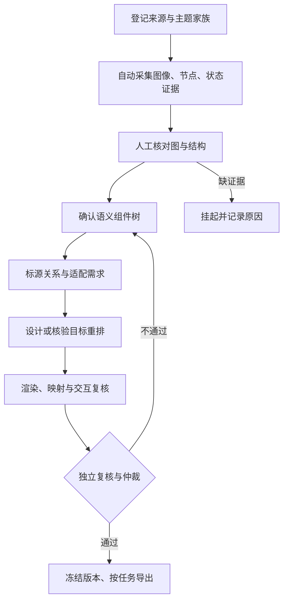

# 人工标注流程

先完成 10 个左右主题家族、20–30 个代表状态的试标，再决定正式批次规模。数量是启动建议，不是证明模型效果所需的充分规模。当前可从已盘点的 24 个源包中选样，但相近模板需要合并家族。



## 0. 分工、选样与登记

负责人准备 `templates/batch-register.csv`，记录任务 ID、主题家族、源状态、目标画布、标注人、复核人和进度。家族按共用模板、脚本结构和素材来源核对；不同文件名不能证明不同家族。

首批覆盖：简洁时间、图文组合、前景景深、底部独立快捷入口、设置/抽屉、重复选项网格、动态媒体。不能只挑最容易渲染的主题；无法处理的类别保留缺口统计。

准备 train / validation / test 家族清单并固定。试点可按约 70/15/15 的家族比例规划，实际报告家族数和样本数。只有十个家族时结果波动很大，先作为工程试点，不能包装为可靠泛化结论。

**产物**：来源登记、家族映射、目标画布列表、采样矩阵。**验收**：同家族不跨集合，来源版本可追溯。

## 1. 机器准备“证据包”，不要准备人工答案

复用现有解析器提取脚本、素材索引、状态图和源布局，固定时间、日期、天气与持久变量，记录实际动作轨迹及动画相位。原始节点和关系推断保留为候选，状态不完整也应如实记录。

每个任务准备：

- 源整屏图与源状态节点目录；必要时局部放大图。
- 脚本求值框、可见性、资源路径与底层节点 ID。
- 状态快照及进入路径；目标画布、安全区与明确的适配需求。
- 原生目标参考（如果有），单独存放并注明来源；第一轮源结构标注时先隐藏。

创建空白表单：

```powershell
# 从项目根目录执行。只创建空白任务，不推断人工标签。
.\.venv\Scripts\python.exe .\theme-layout-dataset\annotation_tasks.py init --id pilot-001

# 或从已解析 project.json 指定状态，只装入脚本事实和来源哈希。
.\.venv\Scripts\python.exe .\theme-layout-dataset\annotation_tasks.py states --project <project.json的实际路径>
.\.venv\Scripts\python.exe .\theme-layout-dataset\annotation_tasks.py init --id pilot-002 --project <project.json的实际路径> --state <实际状态ID>
```

CLI 中相对路径以本工作区为基准；绝对路径同样支持。第二种方式只导出节点/状态事实，组件与目标字段仍留空。源截图路径需要填入已核对的截图，并补充其哈希。

**产物**：`annotations/<id>.json`、可选 `annotations/facts/<id>.json`。**验收**：截图、状态、画布和脚本来自同一版本。初始 `draft/pending` 不能导出为真值。

## 2. 第一遍人工：只核源图与结构

标注者暂不看算法适配结果和目标设计图，避免直接模仿候选。

1. 核对缺图、错图、时间相位与面板状态。
2. 区分当前可见、隐藏、屏外、遮挡、缺资源和渲染不支持。
3. 对无法可靠核验的任务标 `blocked` 并填原因；不要补画一个猜测的画面。

**产物**：源证据核验结果。**验收**：不把渲染错误当作布局缺陷，不因当前不可见删除脚本节点。

## 3. 第二遍人工：组件树，先父后子

先回答“这屏由哪几个可以独立安排的功能区组成”，再回答“哪个功能区内部需要重排”。

1. 给主要功能区命名并建立父子关系。
2. 将原节点绑定到最低适当组件；专属装饰与热区跟随绑定。
3. 标出刚性组、行列/网格容器、叠层与可移动子组。
4. 检查全局任务是否复杂；复杂时建立局部任务，保留整屏上下文和父容器范围。
5. 按隐藏节点/控制节点/纯背景等类别批量记录排除理由，不逐个重复书写相同说明。

**产物**：组件树和成员映射。**验收**：无环、无重复所有权、关键可见功能无遗漏；两个必须独立移动的对象未被冻成一个组。

## 4. 第三遍人工：关系与适配需求

1. 标源图中观察到的关系；注明这是观察，还是已确认的设计意图。
2. 登记目标需求：目标画布、安全区、应保留的功能、可变结构、背景主体限制。
3. 逐条标出关系在目标上 `preserve/change/optional`，尤其是居中、贴边、相邻间距、可读性与景深遮挡。
4. 每个复杂容器写内部布局策略；不枚举所有节点两两关系。

若没有明确目标需求或设计目标，又存在多个明显不同的合理方案，先补充 brief 或保留多方案，不让标注者猜唯一答案。

**产物**：关系和约束清单。**验收**：参照物、范围、单位和来源明确；事后总结的目标细节不能冒充事前需求。

## 5. 第四遍人工：目标重排与局部任务

原生双形态：先确认用途、样式、关键变量和身份映射，再提取目标框。没有原生目标：由标注者/设计师在源素材上设计适配方案，记录短的决策说明。

先安排主要区域，再安排语义组件，只有必须改变组内结构时才进入局部任务。局部任务输入同时提供整屏上下文、父区域和局部图；不要只给一个脱离上下文的裁剪。

目标必须经过素材重排后的实际渲染核验。拖动标注框不会自动证明素材排布正确；不会执行的拓扑变化单独挂起。算法候选可在独立设计后用作参考，仍保留候选来源。

**产物**：目标组框、映射、关系变化、布局模式与参考图。**验收**：可执行、保留资源身份；无法用当前协议表达的设计不混入根组训练。

## 6. 自动检查与设计复核分两关

先检查草稿结构：

```powershell
.\.venv\Scripts\python.exe .\theme-layout-dataset\annotation_tasks.py validate --task annotations/pilot-001.json
```

标注者用 `templates/quality-checklist.csv` 逐项登记：图像一致性、组件成员、关系、目标映射、可读性、意外遮挡、热区、跨状态一致性、写回。与当前任务确实无关的项目可 `not_applicable`，需写明原因。

自动检查只覆盖字段、ID、树、坐标、引用与门禁条件。截图设计好坏、关系语义、执行效果和交互证据必须人工/实际运行核验。

**产物**：质检表与错误记录。**验收**：几何正确和语义正确同时满足，不能用总体美观评分抵消热区错位等硬错误。

## 7. 独立双标、仲裁与试标回顾

复核者先独立看源图和 brief，再看第一人的方案。先比较分组/关系等事实与约束，再比较目标框，避免以“框差异大”直接否定另一个合理方案。

记录分歧类型：组件边界、语义角色、源目标映射、关系强度、重排模式、审美选择。事实冲突由证据裁定；合理设计分歧可保留不同方案，并固定采样权重。

试标统计：每条用时、挂起原因、分组成员一致性、关系一致性、目标方案一致性、执行失败率。建议在 20–30 个状态上先达到主要事实标签约 90% 的一致性再扩批；这是内部起点，必须公布计算口径，不是通用学术阈值。

分组比较用节点对“是否同组”的 Precision/Recall/F1；关系按类型和对象对比较，强度另算；框误差只在身份和设计方案可比时计算。用时需实际记录，不预先承诺每条几分钟。

**产物**：仲裁记录、规范修订清单。**验收**：规则修改后回查受影响的已标任务，规范版本和任务版本一致。

## 8. 冻结与交付训练

完成人工复核后将 stage 设为 `released` 并运行：

```powershell
.\.venv\Scripts\python.exe .\theme-layout-dataset\annotation_tasks.py validate --task annotations/pilot-001.json --release
.\.venv\Scripts\python.exe .\theme-layout-dataset\annotation_tasks.py batch --directory annotations --release
```

冻结来源/标签/拆分清单、截图及哈希。不要在已冻结测试集上反复修标签来迎合模型；修正事实错误时升版本并保留日志。

第一批交付应包含“可训练数据、待补证据、需要拓扑支持、被拒绝”各自数量和原因，不能只报成功样本。训练数据按第四份文档的任务白名单导出；本轮没有执行微调或代做标签。
