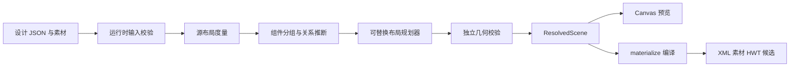

# 响应式重构：设计意图到脚本

## 参考依据与采用方式

| 来源 | 采用的思路 | 本项目实现 |
|---|---|---|
| [Figma Auto Layout](https://help.figma.com/hc/en-us/articles/360040451373-Guide-to-auto-layout-in-Figma) | 固定、内容适应、填充、间距、内边距、对齐；脱离自动流的叠层 | `sizing`、`autoLayout`、`responsive.position` |
| [Figma Constraints](https://help.figma.com/hc/en-us/articles/360039957734-Apply-constraints-to-define-how-layers-resize) | 分别表达水平与垂直锚点 | 节点约束与组件组居中/边缘关系 |
| [Android Window Size Classes](https://developer.android.com/develop/ui/compose/layouts/adaptive/use-window-size-classes) | 根据可用窗口而非设备名称作高层布局决策；宽高分别考虑 | 逻辑宽、目标高度、比例和安全区域驱动构图。现有三档是项目配置，不宣称覆盖 Android 最新全部档位 |
| [Android Canonical Layouts](https://developer.android.com/develop/ui/views/layout/canonical-layouts) | 内容角色决定主辅分区、多栏等布局 | `split/grid/focus-dock` 的启发式分区，不复制应用导航到锁屏 |
| [Android Fold-aware Layout](https://developer.android.com/develop/ui/compose/layouts/adaptive/foldables/make-your-app-fold-aware) | 明确折叠姿态、分隔与遮挡，不只看宽高比 | `posture/features`；按真实配置划分可用区域 |
| [华为开发者：一多开发](https://developer.huawei.com/consumer/cn/blog/topic/03191706893762016) | 断点、媒体特征、栅格；缩放、均分、拉伸等能力组合 | 设备 JSON、形状变体、语义组栅格与等比变换；不依赖品牌白名单 |

以上是设计依据。本实现是本地 TypeScript 代码，没有复制 Figma 或旧版 ThemeStudio 的闭源代码。

## 边界



`core/solve.ts` 是唯一求解入口。新功能应放在对应层；UI 不计算另一套导出坐标，XML 编译器不重新猜组或排布。

## 保真顺序

1. 作者的显式变体与资源身份。
2. 节点、原子组、热区和组内比例。
3. 安全区域、显示障碍、无新增组间重叠。
4. 居中、角落、阅读顺序与源间距。
5. 构图偏好、间距、均衡程度。

单图和静态矩形不能证明动画全过程、交互可达性和作者语义。屏外等待、弹层需要显式提示；脚本状态分析使用已有 Python 引擎，不能只根据截图补造状态。

## 规划器协议

`PlannerInput = { doc, device, groups }`。每个组有成员、源框、语义、锚点、可信度和推断证据。

`LayoutExplanation` 返回 `placements[]`，每项包含已知组 ID、目标框、单一比例和原因。外部规划器收到副本，原设计身份和安全区域由主流程维护。校验未知/重复/遗漏组、非法尺寸、比例、越界、新增重叠。不能用模型建议覆盖硬性限制。

```ts
import { resolveDoc } from '../src/core/solve.js';
import { SemanticPlanner, type LayoutPlanner, type PlannerInput } from '../src/core/layout/planner.js';

class MyPlanner implements LayoutPlanner {
  name = 'my-layout-v1';
  plan(input: PlannerInput) {
    // 可替换为自己的约束求解或模型规划；输出仍经过独立校验。
    return new SemanticPlanner().plan({
      ...input,
      doc: { ...input.doc, layout: { ...input.doc.layout, mode: 'auto', composition: 'grid' } },
    });
  }
}

// const scene = resolveDoc(doc, device, { planner: new MyPlanner() });
```

## 像素和逻辑尺寸

- 设计框是设计像素；目标框是目标像素。
- `density = device.width / device.widthDp`；dp 限制在目标密度下检查。
- 组内资源和热区用同一平移与单一比例；背景可以 cover 裁切。
- 普通柔性折痕默认可跨越。不可跨越的区域必须由设备配置明确声明。
- 仅凭图片无法恢复设备密度、安全区、系统指纹区；不对不存在的元数据作推断。

## 导出

`materialize` 将求解后的可见性、文本、尺寸、颜色、动作和子树转成编译输入。文本中心/右对齐先转换到原生锚点，子坐标减父坐标一次。动态时间不烘焙为演示时刻。

HWT 必须包含所有实际引用静态图片字节。位图字体族尚未接入此编译器，明确拒绝打包；不得把字体预览、视频首帧或占位色块冒充原生资源。

自动重构暂不输出单个可覆盖任意设备的动态脚本。线性表达式无法准确表达栅格重分区、内容度量和设备姿态；逐目标编译是当前可靠边界。后续可增加原生断点/状态路由后端，而不是维护第二套布局公式。
